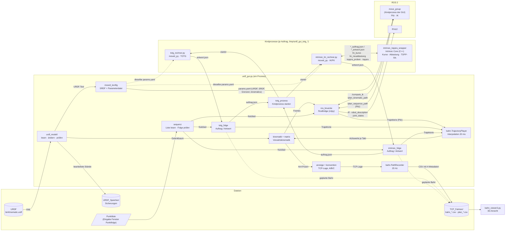

# URDF-GUI für Bahnplanung

Tkinter-Oberfläche für ROS 2 (Jazzy) und MoveIt: URDF laden und bearbeiten,
Achsen vorgeben, Vorwärtskinematik rechnen, TF senden, Punktfolgen planen,
abfahren und als CSV aufzeichnen.

Für Punktfolgen stehen drei Verfahren nebeneinander, damit man sie vergleichen kann:

| Verfahren | Rechnung | Ort |
|---|---|---|
| **Pilz** | `MotionSequenceRequest` an move_group (mit Überschleifen) | `ros_bruecke.py` |
| **TOTG** | MoveIt `TimeOptimalTrajectoryGeneration` über moveit_py | Kindprozess `totg_rechner.py` |
| **Intrinsic** | kartesisch linear (LIN) mit Kurve und TOPP-RA aus Intrinsic Core, IK/FK aus MoveIt | Kindprozess `intrinsic_lin_rechner.py` |

Aufgezeichnete Bahnen sieht man sich mit dem eigenständigen `bahn_viewer3.py`
an. Er braucht weder ROS noch die URDF.

## Voraussetzungen

- ROS 2 Jazzy mit MoveIt, `moveit_py` (`sudo apt install ros-jazzy-moveit-py`) und RViz2
- Python 3.12 mit `tkinter` und `PyYAML`
- Für Intrinsic: der `intrinsic_toppra_wrapper`. Er liegt fertig gebaut in
  [intrinsic_toppra_wrapper/bin/](intrinsic_toppra_wrapper/bin/) und wird über
  `INTRINSIC_WRAPPER` eingebunden (`docs/Bedienerdokumentation.md`, Abschnitt 2.5).
  Braucht Ubuntu 24.04 und einen Prozessor mit AVX2. Selbst bauen mit Bazel nur
  nach Änderungen am Wrapper (ebenda, Anhang B)
- Optional für die einstellbare Pilz-Abtastzeit: MoveIt-Overlay mit
  [patch_pilz_sampling_time_1.py](patch_pilz_sampling_time_1.py) (Abschnitt 2.4 ebenda)

URDF (`bmKinematic.urdf`), Sicherungen (`URDF_Speicher/`) und Aufzeichnungen
(`TCP_Fahrten/`) liegen standardmäßig neben den Skripten. Umlenken lassen sie
sich über Umgebungsvariablen (siehe unten), ohne
[einstellungen.py](einstellungen.py) zu ändern. Alle weiteren Stellschrauben
stehen unter [Einstellbare Werte](#einstellbare-werte).

## Herunterladen

Direkt in Ubuntu/WSL klonen, nicht unter Windows (sonst entstehen
`Zone.Identifier`-Dateien und der Wrapper verliert sein Ausführrecht):

```bash
cd ~
git clone https://github.com/fkwohlfeil/Display.git     # legt ~/Display an
cd ~/Display && git pull                                 # später aktualisieren
```

Ohne Git geht es über das Archiv (dann kein `git pull`). Der Ordner heißt
darin `Display-main` und wird umbenannt:

```bash
cd ~
curl -L https://github.com/fkwohlfeil/Display/archive/refs/heads/main.tar.gz | tar xz
mv Display-main Display
```

Weitere Wege (ZIP im Browser, nur ein Ordner) stehen in
`docs/Bedienerdokumentation.md`, Abschnitt 2.3.

## Starten

```bash
source /opt/ros/jazzy/setup.bash
cd ~/Display

ros2 launch display_launch4.py                       # GUI + RViz2
ros2 launch display_launch4.py urdf:=/pfad/robot.urdf
ros2 launch display_launch4.py rviz:=false           # nur die GUI
ros2 launch display_launch4.py software_gl:=false    # native GPU; nicht unter WSL
ros2 launch display_launch4.py intrinsic_wrapper:=/pfad/zum/intrinsic_toppra_wrapper
```

Das Launch-Skript wird nicht als Package installiert. Es liegt neben der GUI
und löst alle Pfade relativ zu sich selbst auf. Den Wrapper reicht es als
Umgebungsvariable `INTRINSIC_WRAPPER` an die GUI weiter. Wird das GUI-Fenster
geschlossen, fährt das ganze Launch herunter.

Den Bahn-Viewer startet man ohne ROS:

```bash
python3 bahn_viewer3.py TCP_Fahrten/bahn_20260915_084009.csv
python3 bahn_viewer3.py --pruefen TCP_Fahrten/*.csv   # nur einlesen, kein Fenster
```

## Einstellbare Werte

Die Werte sind nach Ort geordnet. Zuerst kommen die, die sich ohne
Codeänderung setzen lassen.

> **Bevor du eine Konstante änderst:**
> - Ändere sie in dem Modul, das sie definiert. `urdf_gui.py` hält nur eine
>   Kopie der Bindung, eine Änderung dort wirkt nicht in den anderen Modulen.
> - In den Basismodulen (`einstellungen`, `bahn`, `moveit_konfig` …) gehört zu
>   einer Änderung auch ein neuer `STAND` im Modul und in `MODUL_STAENDE` in
>   `urdf_gui.py`. Sonst lässt sich eine Messreihe nicht mehr eindeutig einer
>   Fassung zuordnen.
> - Einige Grenzen spiegeln Vorgaben von MoveIt, Pilz-Patch oder Intrinsic
>   Core. Sie sind unten mit *(gespiegelt)* markiert. Bei Abweichung gilt das
>   Original, die Kopie dient nur der früheren Rückmeldung.

### 1. Beim Start

**Launch-Argumente** (`display_launch4.py`)

| Argument | Standard | Bedeutung |
|---|---|---|
| `urdf` | `bmKinematic.urdf` neben dem Skript | geladenes Robotermodell |
| `rviz` | `true` | RViz2 mitstarten |
| `rviz_config` | `display2.rviz` | RViz-Konfiguration |
| `software_gl` | `true` | setzt `LIBGL_ALWAYS_SOFTWARE=1`; unter WSL nötig, auf nativer GPU `false` |
| `intrinsic_wrapper` | `$INTRINSIC_WRAPPER` oder `~/intrinsic-core/bazel-bin/intrinsic_toppra_wrapper/intrinsic_toppra_wrapper` | Pfad zum gebauten Wrapper |

**Umgebungsvariablen**

| Variable | Wirkung |
|---|---|
| `INTRINSIC_WRAPPER` | Pfad zum Wrapper. Hat Vorrang vor `WRAPPER_STANDARD` in `intrinsic_folge.py` |
| `LIBGL_ALWAYS_SOFTWARE` | Software-Rendering für RViz (setzt das Launch über `software_gl`) |
| `URDF_GUI_URDF` | URDF, wenn beim Start keine angegeben ist (Standard `bmKinematic.urdf` neben den Skripten) |
| `URDF_GUI_SICHERUNG` | Ablage für Sicherungen der URDF (Standard `URDF_Speicher/`) |
| `URDF_GUI_BAHNEN` | Ablage für CSV-Bahnen (Standard `TCP_Fahrten/`) |

**Aufruf ohne Launch:** `python3 urdf_gui.py [URDF]`. Ohne Argument gilt
`URDF_PATH` aus `einstellungen.py`.

### 2. In der Oberfläche

Diese Werte setzt man in der GUI. Die Tabellen nennen die Voreinstellung,
die im Code steht.

**Fenster „Bewegungsparameter“, Planung je Auftrag** (`moveit_konfig.PLAN_FIELDS`, ohne Neustart von move_group)

| Feld | Einheit | Standard |
|---|---|---|
| `velocity_scaling`: Override Geschwindigkeit | % | 100 |
| `acceleration_scaling`: Override Beschleunigung | % | 100 |
| `planning_time`: Planungszeit | s | 5.0 |
| `planning_attempts`: Versuche | – | 1 |
| `goal_orientation_tol`: Zieltoleranz Achsen | deg | 0.1 |
| `blend_radius`: Überschleifradius (Anfangswert der Punktliste) | m | 0.0 |

Die beiden Overrides stehen zusätzlich im Fenster „Fahren“. Seit 2.3 fehlen
`goal_position_tol`, `max_step` und `jump_threshold`: sie gingen in keinen
Auftrag ein.

**Hauptfenster, Karte „BEWEGUNG“**: Bahngeschwindigkeit und
Bahnbeschleunigung, dieselben Werte wie `max_trans_vel` und `max_trans_acc`
unten (Neustart nötig). Die Bahnverzögerung folgt beim Übernehmen der
Beschleunigung; das Meldungsfenster sagt es.

**Fenster „Bewegungsparameter“, Einrichtung** (diese Werte gehen in die MoveIt-Parameterdatei)

| Gruppe | Feld | Einheit | Standard |
|---|---|---|---|
| Achsgrenzen je Gelenk (`LIMIT_FIELDS`) | `velocity`, `acceleration`, `deceleration`, `jerk` | rad/s … rad/s³ | leer = Grenze aus |
| Kartesisch, Pilz (`CARTESIAN_FIELDS`) | `max_trans_vel` | m/s | 1.000 |
| | `max_trans_acc` | m/s² | 2.250 |
| | `max_trans_dec` | m/s² | −5.000 |
| | `max_rot_vel` | rad/s | 1.570 |
| Planer, Pilz (`PLANNER_FIELDS`) | `sampling_time` (wirkt nur mit `patch_pilz_sampling_time_1.py`) | s | 0.100 (gültig 1e‑4 … 1.0, *gespiegelt*) |
| Kinematik (`KINEMATICS_FIELDS`) | Solver: KDL, TRAC‑IK oder LMA | – | KDL |
| | `kinematics_solver_timeout` | s | 0.050 |
| | `kinematics_solver_search_resolution` | rad | 0.005 |
| nur KDL (`KDL_FIELDS`) | `max_solver_iterations` (Ganzzahl!) | – | 500 |
| | `epsilon` | – | 1e‑5 |
| | `orientation_vs_position` | – | 1.0 |
| | `position_only_ik` | – | aus |

Fehlen Beschleunigung oder Ruck in der URDF, leitet `moveit_konfig.py` sie ab:
Beschleunigung = `ACC_FROM_VEL` (2.0) × Geschwindigkeit, Ruck =
`JERK_FROM_ACC` (10.0) × Beschleunigung. Fehlt auch die Geschwindigkeit,
gilt `DEFAULT_JOINT_VELOCITY` (1.0 rad/s bzw. m/s).

**Fenster „Punktfolge“, Felder je Verfahren**

| Feld | Einheit | Verfahren | Standard | Gültig |
|---|---|---|---|---|
| `path_tolerance` | rad | TOTG | 0.1 | > 0 … 10 |
| `resample_dt` | s | TOTG, Intrinsic | 0.01 | 1e‑4 … 1.0 |
| `rundung_rot` | rad | Intrinsic | 0.1 | 1e‑6 … π |
| `gelenk_abtastung` | rad | Intrinsic | 0.05 | 1e‑4 … 1.0 |
| `ueberschleifen` | rad | Intrinsic | 0.2 | 1e‑5 … π |
| `v_bahn` (TCP-Geschwindigkeit) | m/s | Intrinsic | leer = keine Grenze | 1e‑4 … 10 |
| `a_bahn` (TCP-Beschleunigung) | m/s² | Intrinsic | leer = keine Grenze | 1e‑3 … 100 |

Der translatorische Verrundungsradius für Intrinsic ist der `radius` der
Punktliste. Für die ganze Kurve gilt ein einziger Wert über null.

**Punktliste: modale Felder** (`sequenz.MODAL_START`). Diese Werte gelten, bis
eine Zeile sie überschreibt.

| Feld | Standard |
|---|---|
| `fahrart` | PTP (Pilz: PTP, LIN, CIRC; Intrinsic: LIN, PTP) |
| `tempo` | 10 % |
| `beschleunigung` | 10 % |
| `radius` | 0.0 m (Genauhalt) |

Achsziele beginnen mit `J`. Für sie gilt fest PTP mit Radius 0.

### 3. Im Code

#### `einstellungen.py`: Einrichtung

| Konstante | Standard | Bedeutung |
|---|---|---|
| `URDF_PATH` | `bmKinematic.urdf` neben dem Modul, oder `$URDF_GUI_URDF` | URDF, wenn beim Start keine angegeben ist |
| `BACKUP_DIR` | `URDF_Speicher/` neben dem Modul, oder `$URDF_GUI_SICHERUNG` | Ablage bearbeiteter URDF-Stände (absolut oder relativ zur URDF) |
| `BAHN_DIR` | `TCP_Fahrten/` neben dem Modul, oder `$URDF_GUI_BAHNEN` | Ziel der CSV-Aufzeichnungen |
| `BAHN_VIEWER` | `bahn_viewer3.py` | Bahnansicht, die die GUI nach einem Export nennt |
| `TF_RATE_HZ` | 30.0 | Takt der TF-Ausgabe |
| `FOOTER_TICK_MS` | 50 | Aktualisierung der Fußzeile |
| `MAX_LOG_LINES` | 600 | Zeilen im Meldungsfenster |
| `MAX_HISTORY` | 25 | Tiefe von Rückgängig |
| `SLIDER_REFRESH_MS` | 60 | Tabellen-Neubau beim Ziehen am Schieber (TF bekommt den Wert sofort) |
| `FREE_ROTATION_DEG` | 180.0 | Schieberspanne ohne URDF-Anschlag, Drehachse |
| `FREE_TRAVEL_M` | 1.0 | Schieberspanne ohne URDF-Anschlag, Schubachse |
| `SLIDER_STEPS` | 1000 | angestrebte Stufen je Schieber |
| `RECORD_RATE_HZ` | 25.0 | Takt des Bahnrekorders (`RECORD_TICK_MS` folgt daraus) |
| `RECORD_MIN_DIST_M` | 0.0005 | Mindestweg des TCP für einen neuen Punkt |
| `RECORD_MIN_ANGLE_DEG` | 0.5 | Mindestdrehung des TCP für einen neuen Punkt |
| `RECORD_MIN_JOINT_DEG` | 0.5 | Mindeständerung einer Achse für einen neuen Punkt |
| `RECORD_MAX_POINTS` | 20000 | Obergrenze im Speicher (≈ 13 min bei 25 Hz) |

#### `bahn.py`: Fahren, Bremsen, Joggen

| Konstante | Standard | Bedeutung |
|---|---|---|
| `IPO_TICK_MS` | 20 | Interpolationstakt der GUI (`IPO_DT` folgt daraus) |
| `BRAKE_TIME_S` | 0.40 | Rampe von voller Rate auf null beim Anhalten |
| `HOLD_WATCH_MS` | 100 | Wachhund am Halte-Taster |
| `JOB_RATE_HZ` | 20.0 | Executor-Thread prüft auf neue Aufträge |
| `SPIN_ERROR_LIMIT` | 20 | Ausnahmen im ROS-Takt, bevor er aufgibt |
| `TF_STALL_MS` | 1000.0 | Alter der letzten TF-Ausgabe, ab dem gewarnt wird |
| `IK_TIMEOUT_MARGIN_S` | 5.0 | Zuschlag auf die Zeitgrenze des IK-Solvers |
| `JOG_STEP_M` / `JOG_STEP_DEG` | 0.01 m / 0.1° | Schritt je Klick beim kartesischen Joggen |
| `JOG_VEL_M_S` / `JOG_VEL_DEG_S` | 0.02 m/s / 0.2 °/s | Geschwindigkeit beim Halten |
| `JOG_HOLD_DELAY_MS` | 300 | ab hier wird aus dem Klick ein Halten |
| `JOG_MAX_DT_S` | 0.25 | größter Zeitschritt beim Joggen |
| `JOG_TICK_MS` | 50 | Takt der Achs-Dauerfahrt |
| `JOG_WARN_SHARE` / `JOG_CLEAR_SHARE` | 0.75 / 0.65 | Hysterese der Warnung zur Achsauslastung |
| `FOLGE_START_TOL` | 1e‑4 rad | größte Abweichung zum ersten Stützpunkt, bei der eine Folge noch gefahren wird |

#### `moveit_konfig.py`: move_group

| Konstante | Standard | Bedeutung |
|---|---|---|
| `MOVEIT_GROUP` | `manipulator` | Planungsgruppe in der erzeugten SRDF |
| `MOVEIT_WAIT_S` | 25.0 | Wartezeit auf move_group, danach „keine Antwort“ |
| `PLAN_TIMEOUT_MARGIN_S` | 10.0 | Zuschlag auf die Planungszeit |
| `ACC_FROM_VEL`, `JERK_FROM_ACC`, `DEFAULT_JOINT_VELOCITY` | 2.0, 10.0, 1.0 | Ableitung fehlender Achsgrenzen (siehe oben) |
| `SAMPLING_TIME_MIN` / `_MAX` | 1e‑4 / 1.0 s | Grenzen der Pilz-Abtastzeit *(gespiegelt)* |

Die Voreinstellungen der Felder aus Abschnitt 2 stehen ebenfalls hier, als
4. Spalte von `PLAN_FIELDS`, `CARTESIAN_FIELDS`, `PLANNER_FIELDS`,
`KINEMATICS_FIELDS` und `KDL_FIELDS`.

#### `sequenz.py`: Punktfolge (Pilz)

| Konstante | Standard | Bedeutung |
|---|---|---|
| `MODAL_START` | PTP, 10 %, 10 %, 0 m | Voreinstellung der modalen Felder |
| `ACHSZIEL_KENNUNG` | `J` | Kennung eines Achsziels am Zeilenanfang |
| `FRIST_ZUSCHLAG_S` | 5.0 | Zuschlag auf die Summe der Planungszeiten |
| `ORT_GLEICH_M` | 1e‑9 | ab hier gelten zwei Punkte als derselbe Ort |

#### `totg_folge.py`: TOTG

| Konstante | Standard | Bedeutung |
|---|---|---|
| `PATH_TOLERANCE_STANDARD` | 0.1 | Voreinstellung `path_tolerance` (wie MoveIt) |
| `RESAMPLE_DT_STANDARD` | 0.01 s | Voreinstellung `resample_dt` (MoveIt: 0.1) |
| `MIN_ANGLE_CHANGE` | 0.001 | Punkte mit kleinerer Änderung werden verworfen (wie MoveIt) |
| `PATH_TOLERANCE_MAX` | 10.0 | Eingabegrenze |
| `RESAMPLE_DT_MIN` / `_MAX` | 1e‑4 / 1.0 s | Eingabegrenzen |
| `FRIST_S` | 90.0 | Zeitlimit für `totg_rechner.py` |
| `UMKEHR_TOLERANZ` | 1e‑5 | ab hier gilt eine Ecke als Umkehr *(gespiegelt aus `Path::create`)* |

#### `intrinsic_folge.py`: Intrinsic, Seite der GUI

| Konstante | Standard | Bedeutung |
|---|---|---|
| `WRAPPER_STANDARD` | `~/intrinsic-core/bazel-bin/…/intrinsic_toppra_wrapper` | Wrapper, wenn `INTRINSIC_WRAPPER` nicht gesetzt ist |
| `AST_FOLGEN` | `True` | LIN-Kette endet auf anderem IK-Ast: weiterfahren statt abbrechen |
| `UEBERSCHLEIFEN_RAD` | 0.2 | Überschleifen im Gelenkraum (wie Intrinsic) |
| `RUNDUNG_ROT_STANDARD` | 0.1 rad | Voreinstellung `rundung_rot` |
| `RUNDUNG_TRANS_OHNE_RADIUS` | 0.001 m | translatorische Verrundung, wenn kein Radius > 0 in der Liste steht |
| `RUNDUNG_ROT_MIN` / `_MAX` | 1e‑6 / π | Eingabegrenzen |
| `GELENK_ABTASTUNG_STANDARD` | 0.05 rad | Voreinstellung `gelenk_abtastung` |
| `GELENK_ABTASTUNG_MIN` / `_MAX` | 1e‑4 / 1.0 | Eingabegrenzen |
| `UEBERSCHLEIFEN_MIN` / `_MAX` | 1e‑5 / π | Eingabegrenzen *(Minimum gespiegelt aus Intrinsic)* |
| `TCP_V_MIN` / `TCP_V_MAX` | 1e‑4 / 10 m/s | Eingabegrenzen `v_bahn` |
| `TCP_A_MIN` / `TCP_A_MAX` | 1e‑3 / 100 m/s² | Eingabegrenzen `a_bahn` |
| `FRIST_S` | 300.0 | Zeitlimit für `intrinsic_lin_rechner.py` |

#### `intrinsic_lin_rechner.py`: Intrinsic, Rechnung

| Konstante | Standard | Bedeutung |
|---|---|---|
| `STANDARD["abtastung_translation_m"]` | 0.002 | Abtastung der kartesischen Kurve, Lage *(wie Intrinsic)* |
| `STANDARD["abtastung_rotation_rad"]` | 0.005 | Abtastung der kartesischen Kurve, Drehung *(wie Intrinsic)* |
| `STANDARD["gelenk_abtastung_rad"]` | 0.05 | Neuabtastung im Gelenkraum *(wie Intrinsic)* |
| `STANDARD["ueberschleifen_rad"]` | 0.2 | Überschleifen bei TOPP-RA *(wie Intrinsic)* |
| `IK_TOLERANZ_M` / `IK_TOLERANZ_RAD` | 1e‑3 m / 1e‑2 rad | größte FK-Abweichung einer IK-Lösung von der Kurvenpose. Auch im Auftrag als `ik_toleranz_m` / `ik_toleranz_rad` setzbar |
| `MAX_IK_SPRUNG_RAD` | π/4 | größter Achssprung zwischen zwei IK-Lösungen *(gespiegelt)* |
| `START_TOLERANZ_RAD` | 1e‑3 | erste IK-Lösung gegen Startstellung *(gespiegelt)* |
| `ZIEL_TOLERANZ_RAD` | 1e‑3 | letzte IK-Lösung gegen Zielwegpunkt *(gespiegelt)* |
| `TCP_PRUEF_TOLERANZ` | 1e‑3 (relativ) | Überschreitung der TCP-Grenzen, ab der die Antwort einen Hinweis trägt |
| `FK_DIFFERENZ_RAD` | 1e‑4 | Schritt der zentralen Differenzen für die TCP-Ableitungen |
| `SINGULAER_RELATIV` | 1e‑6 | Schwelle für Singulärwerte (nur für Fehlermeldungen) |

#### `anzeige.py`, `stil.py`, `bahn_viewer3.py`: Darstellung

| Ort | Konstante | Standard | Bedeutung |
|---|---|---|---|
| `anzeige.py` | `ENTARTUNG_WARNUNG_DEG` | 1.0 | Abstand zur Winkelsingularität, ab dem die TCP-Zeile warnt |
| `konvention.py` | `STANDARD` | `ZYX` | voreingestellte Drehkonvention (ZYX, ZYZ, ZXZ) |
| `stil.py` | `BG`, `SURFACE`, `TEXT`, `ACCENT`, `COLOR_*`, `TINT_*`, `BG_*` … | – | Farbpalette der GUI |
| `stil.py` | `TREE_NODE_W`, `TREE_NODE_H`, `TREE_GAP_X`, `TREE_GAP_Y`, `TREE_MARGIN`, `TREE_GRAB` | 128, 24, 22, 36, 18, 12 px | Maße der Baumansicht |
| `bahn_viewer3.py` | `FAST_MAX_POINTS` | 1500 | Punkte beim Ziehen (vereinfachte Darstellung) |
| `bahn_viewer3.py` | `POINT_BUDGET` | 4000 | höchstens gezeichnete Punkte |
| `bahn_viewer3.py` | `SPEED_BUCKETS` | 24 | Farbstufen der Geschwindigkeitseinfärbung |
| `bahn_viewer3.py` | `VIEWS` | Iso, XY, XZ, YZ | Ansichten (Azimut, Elevation in Grad) |
| `bahn_viewer3.py` | Farben (`PATH`, `MARKER`, `TRACK_COLORS`, `ROOM_COLORS` …) | – | Farbpalette des Viewers |

Nicht aufgeführt sind Konstanten, die nur intern wirken: Zustandsnamen,
Feldlisten, Präfixe der Arbeitsordner und `STAND`-Nummern.

## Aufbau

```
display_launch4.py
 ├─ RViz2 (display2.rviz)
 └─ urdf_gui.py ── Oberfläche (UrdfViewer)
      │  Fenster: Fahren · Bewegungsparameter · Punktfolge · URDF bearbeiten · Frames und Werkzeuge
      │
      ├─ Basismodule (Abhängigkeit nur nach vorn, kein Zyklus)
      │    einstellungen → stil → matrix → anzeige → urdf_modell → kinematik
      │    → moveit_konfig → bahn → totg_prozess → ros_bruecke
      │
      ├─ Reine Rechnung (kein Tk, kein ROS, kein NumPy)
      │    konvention, sequenz, totg_folge, intrinsic_folge
      │
      └─ Kindprozesse (je Auftrag einer, JSON rein und raus, gestartet über TotgProzess)
           totg_rechner.py
           intrinsic_lin_rechner.py ──> intrinsic_toppra_wrapper (Intrinsic Core)

bahn_viewer3.py ── eigenständig, liest nur CSV
```

### Module

| Datei | Inhalt |
|---|---|
| `urdf_gui.py` | Hauptprogramm (Stand 2.3, mit Intrinsic) |
| `einstellungen.py` | Pfade, Takte, Grenzen des Bahnrekorders |
| `stil.py` | Farben, Maße der Baumansicht |
| `matrix.py` | 4×4-Matrizen als Listen |
| `anzeige.py` | Anzeigekonvention, Singleton `ANZEIGE` |
| `konvention.py` | Drehkonventionen ZYX, ZYZ, ZXZ für A, B, C (intrinsisch) |
| `urdf_modell.py` | URDF lesen, ändern, prüfen, speichern |
| `kinematik.py` | Vorwärtskinematik, Layout des Gelenkbaums |
| `moveit_konfig.py` | MoveIt-Konfiguration, SRDF-Bau, move_group als Kindprozess |
| `bahn.py` | Zustände, Hermite-Interpolation, `TrajectoryPlayer`, `PathRecorder` |
| `totg_prozess.py` | `TotgProzess`: Rechner als kurzer Kindprozess |
| `ros_bruecke.py` | `RosBridge`: rclpy, TF, Pilz-Aufrufe (importiert ROS erst in `start()`) |
| `sequenz.py` | Punktliste lesen, Folge prüfen, Nutzlast für `/plan_sequence_path` |
| `totg_folge.py` | Auftrag/Antwort für TOTG, Abschnitte, Eckwerte |
| `intrinsic_folge.py` | Auftrag/Antwort für Intrinsic (LIN und PTP) |
| `totg_rechner.py` | TOTG aus MoveIt (`AUFTRAG.json ANTWORT.json` oder `--pruefen`) |
| `intrinsic_lin_rechner.py` | LIN nach Intrinsic Core mit MoveIt-IK (`AUFTRAG.json ANTWORT.json` oder `--pruefen`) |
| `intrinsic_lin_auftrag.py` | Hilfsskript: macht aus einem TOTG-Auftrag der GUI einen LIN-Auftrag |

### Modulstände

Jedes Basismodul trägt eine Konstante `STAND`. `urdf_gui.py` prüft beim Start
gegen `MODUL_STAENDE` und bricht ab, wenn etwas nicht zusammenpasst. So lässt
sich jede Messreihe genau einer Kombination von Dateien zuordnen. Wer ein
Basismodul ändert, erhöht dort `STAND` und trägt den neuen Wert in
`MODUL_STAENDE` ein.

### Grundsätze

- Vorwärts- und Rückwärtskinematik kommen nur aus MoveIt, mit derselben
  Parameterdatei wie move_group. Es gibt keine zweite Implementierung.
- Radius 0 heißt in allen drei Verfahren Genauhalt.
- MoveIt-Rechnungen mit eigenem rclcpp-Knoten laufen in einem Kindprozess,
  nie im Prozess der Oberfläche.
- Nichts wird stillschweigend korrigiert. Abweichungen stehen in der Antwort,
  im Bericht und in der CSV.

## Datenfluss



So liest man das Diagramm:

- **Durchgezogener Pfeil:** Daten fließen zur Laufzeit.
- **Gestrichelter Pfeil:** dieselbe Datei wird mitbenutzt oder zusätzlich geschrieben.
- **Doppelpfeil:** Anfrage und Antwort, bei ROS-Diensten oder beim JSON-Austausch mit dem Wrapper.

Die GUI ist die einzige Quelle für `/tf` und `robot_description`. Feste
Gelenke gehen bewusst auch über `/tf`, nicht über `/tf_static`. Die
Kindprozesse lesen dieselbe Parameterdatei wie move_group. Dadurch rechnen
alle drei Verfahren mit derselben URDF, SRDF und Kinematik.

## Ablauf einer Punktfolge

1. Im Fenster **Punktfolge** die Liste eingeben. `sequenz.lies_liste` liest
   sie, `sequenz.Folge` prüft sie.
2. Das Verfahren wählen:
   - **Pilz**: `RosBridge` schickt die Folge an move_group.
   - **TOTG**: `totg_folge.anfrage` → `totg_rechner.py` → `totg_folge.antwort_lesen`.
   - **Intrinsic**: `intrinsic_folge.anfrage` → `intrinsic_lin_rechner.py` →
     `intrinsic_folge.antwort_lesen`. Der Rechner ruft den Wrapper in den
     Modi `lin_kurve`, `lin_neuabtastung`, `toppra_proben` und `toppra` auf.
3. Abfahren mit `TrajectoryPlayer`. `PathRecorder` schreibt die Bahn mit
   25 Hz nach `TCP_Fahrten/`.
4. Auswerten mit `bahn_viewer3.py`.

Grenzen der Intrinsic-Variante: kein Ruck-Limit, keine Kollisionsprüfung,
nur ein Verrundungsradius für die ganze Kurve, keine CIRC-Bewegung.
Optional lassen sich TCP-Grenzen setzen (`tcp_v_max`, `tcp_a_max`).
Einzelheiten stehen im Kopfkommentar von `intrinsic_lin_rechner.py`.

## Daten

| Ordner/Datei | Inhalt |
|---|---|
| `TCP_Fahrten/bahn_*.csv` | aufgezeichnete Fahrten |
| `TCP_Fahrten/plan_*.csv` | geplante Bahnen. Bei `plan_intrinsic_*` sind die Parameter im Namen kodiert, z. B. `r` Radius, `v` Override, `ga`, `ue` |
| `bmKinematic.urdf` | Robotermodell |
| `intrinsic_toppra_wrapper/` | Wrapper: fertiges Programm in `bin/`, Quellen (`BUILD`, `.cc`, `json_klein.h`) und ein Beispielauftrag; gebaut wird nur bei Änderungen, im Baum von Intrinsic Core |
| `patch_pilz_sampling_time_1.py` | Patch für Pilz 2.12.4: Abtastzeit als ROS-Parameter (`--pruefen`, `--zurueck`) |
| `URDF_Speicher/` | automatische Sicherungen bearbeiteter URDF-Stände |
| `Übergabe/Bahnen/` | Punktliste (`bahn_punktliste.txt`) und ausgewählte Intrinsic-Bahnen (`plan_intrinsic_*.csv`) zur Übergabe |
| `archiv/lin_arbeitsdateien/` | frühere Arbeitsdateien des LIN-Rechners (neue im Projektordner ignoriert `.gitignore`) |

Die CSV-Dateien beginnen mit Metadatenzeilen im Format `#schluessel;wert`,
zum Beispiel:

```
#roboter;my_robot
#rate_hz;25
#drehkonvention;ZYX
#tcp;tcp11
#verfahren;Intrinsic
#override_v;100.0
#dauer_s;12.80
```

## Tests

Alle Tests laufen ohne ROS, ohne Tk und ohne Bildschirm:

```bash
python3 test_fassung_2_3.py
python3 test_intrinsic_folge.py
python3 test_intrinsic_lin_rechner.py
python3 test_gui_intrinsic.py
python3 test_moveit_konfig_kdl.py
python3 test_sequenz_kugeln.py

python3 mutation_intrinsic_folge.py   # Mutationsproben: prüft, ob die Tests stark genug sind
```

## Archiv

Seit 2.3 liegt alles, was nicht zum laufenden Stand gehört, unter `archiv/`.
Die Dateien dort sind nicht mehr lauffähig gegen die aktuellen Module (andere
`STAND`-Werte, andere Importpfade) und dienen nur zum Nachlesen:

- `archiv/Gui Versionen/`, `archiv/Display_launch/`: frühere GUI- und Launch-Fassungen
- `archiv/Bahnviewer/`: `bahn_viewer1.py`, `bahn_viewer2.py`
- `archiv/Alte_Tests/`: Tests früherer Fassungen
- `archiv/Math/`: Jacobi, Bahngeometrie, Mathe-Sonden
- `archiv/gui.py`: Stand 2.1 ohne Intrinsic, abgelöst durch `urdf_gui.py`
- `archiv/display.launch2.py`, `archiv/display_launch3.py`: abgelöst durch `display_launch4.py`
- `archiv/lin_arbeitsdateien/`: Aufträge und Antworten früherer Handläufe des LIN-Rechners

Im Projektordner geblieben ist `patch_lin_rechner_mimic_3.py`, der einmalige
Patch des LIN-Rechners auf Stand 3 (Mimic-Gelenke).
