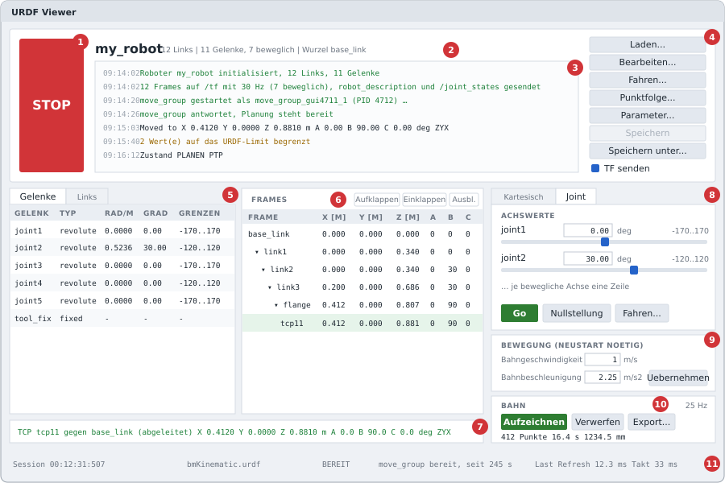
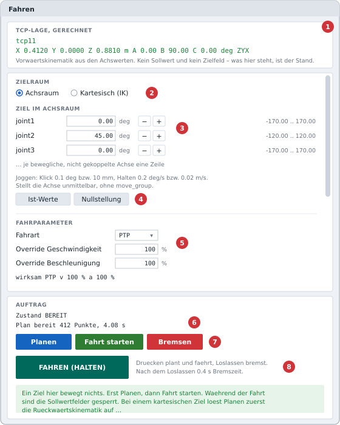
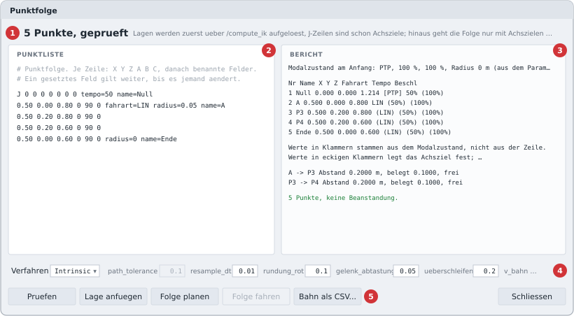
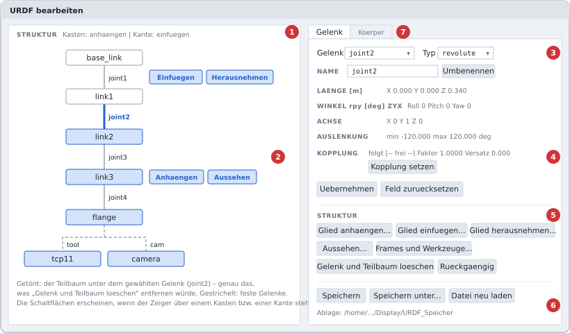
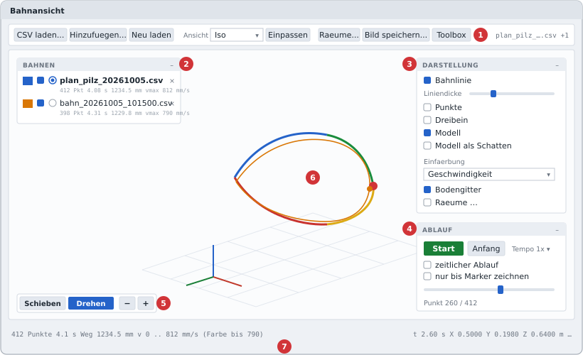

# Teil II · Bedienerdokumentation {#teil-bediener .teil .unnumbered}

::: teilkopf
Für alle, die mit der Oberfläche Bahnen planen, abfahren, aufzeichnen und
vergleichen. Programmierkenntnisse sind nicht nötig; vorausgesetzt werden
Grundbegriffe der Robotik wie Achse, TCP, PTP- und LIN-Bewegung; Abkürzungen
und Fachbegriffe erklärt das Verzeichnis vor Teil I. Die Beschriftungen der
Oberfläche sind ohne Umlaute geschrieben (z. B. „Uebernehmen“); diese Anleitung
zitiert sie genau so, wie sie auf dem Bildschirm stehen.
:::

## 1 Überblick

Die Oberfläche bewegt ein **virtuelles** Robotermodell. Sie stellt die
Achswerte selbst, rechnet daraus die Lage aller Links und schickt sie an
RViz2, das den Roboter zeichnet. Ein echter Roboter wird nicht angesteuert.

Was man damit tun kann:

- ein Robotermodell (URDF) laden, ansehen und bearbeiten,
- Achsen direkt stellen oder joggen,
- Einzelbewegungen planen und abfahren (PTP, LIN),
- Punktfolgen mit drei Verfahren planen und vergleichen (Pilz, TOTG, Intrinsic),
- die Bahn des TCP (Tool Center Point) aufzeichnen und als CSV speichern,
- Bahnen im Programm **Bahnansicht** in 3D ansehen und vergleichen.

| Fenster | geöffnet über | Zweck |
|---|---|---|
| Hauptfenster „URDF Viewer“ | Programmstart | Modellübersicht, Achsen stellen, Aufzeichnen |
| „Bewegungsparameter“ | „Parameter...“ | Planungswerte, Grenzen, `move_group` starten |
| „Fahren“ | „Fahren...“ | Ziel vorgeben, planen, fahren, joggen |
| „Punktfolge“ | „Punktfolge...“ | Punktlisten prüfen, planen, fahren, exportieren |
| „URDF bearbeiten“ | „Bearbeiten...“ | Modell ändern, speichern |
| „Bahnansicht“ | eigenes Programm `bahn_viewer3.py` | CSV-Bahnen in 3D ansehen |

## 2 Installation

Die Schritte bauen einen Rechner so auf, wie die Software getestet ist. Auf
einem fertig eingerichteten Rechner geht es direkt mit Abschnitt 3 weiter.

| Baustein | getesteter Stand | gebraucht für |
|---|---|---|
| Windows 11 mit WSL2 | Windows 11 Pro 23H2 | nur unter Windows; ein nativ installiertes Ubuntu geht ebenso |
| Ubuntu | 24.04 LTS „Noble“ | alles |
| ROS 2 | Jazzy (`ros-jazzy-desktop`) | Oberfläche mit ROS, RViz2 |
| MoveIt 2 mit Pilz | 2.12.4 | Planen, IK, Punktfolgen |
| `moveit_py` | 2.12.4 | Verfahren TOTG und Intrinsic |
| Python | 3.12 mit `tkinter`, PyYAML, NumPy, Pillow | Oberfläche, Rechner, Bildexport der Bahnansicht |
| Intrinsic Core | Release `20260922.0` | nur Verfahren Intrinsic |
| Bazel (über Bazelisk) | 8.8.0 | nur Bau des Intrinsic-Wrappers |

Rechner: x86-64 mit 16 GB Arbeitsspeicher und rund 30 GB freiem Platz, davon
etwa 19 GB allein für den Bazel-Cache von Intrinsic Core.

### 2.1 Ubuntu 24.04 unter Windows (WSL2)

Entfällt bei einem nativ installierten Ubuntu 24.04. In einer PowerShell mit
Administratorrechten:

```powershell
wsl --install -d Ubuntu-24.04
```

Danach Windows neu starten und „Ubuntu 24.04“ aus dem Startmenü öffnen; beim
ersten Start fragt Ubuntu nach Benutzername und Passwort. Dann das System
aktualisieren:

```bash
sudo apt update && sudo apt upgrade -y
```

- Die Fenster der Linux-Programme (Oberfläche, RViz2) zeigt Windows 11 über
  WSLg ohne weitere Einrichtung an.
- RViz2 braucht unter WSL Software-Rendering. Das Launch-Skript setzt es selbst
  (`software_gl:=true`, Standard).
- Im Windows-Explorer sind die Linux-Dateien unter
  `\\wsl.localhost\<Distribution>\home\<benutzer>\` erreichbar, z. B.
  `\\wsl.localhost\Ubuntu-24.04\home\<benutzer>\Display`.

### 2.2 ROS 2 Jazzy und MoveIt 2

Gekürzt nach der offiziellen Anleitung „Ubuntu (deb packages)“ für Jazzy auf
docs.ros.org; bei Abweichungen gilt die offizielle Anleitung.

```bash
# UTF-8-Locale und Paketquelle "universe"
sudo apt update && sudo apt install -y locales software-properties-common curl
sudo locale-gen en_US en_US.UTF-8
sudo update-locale LC_ALL=en_US.UTF-8 LANG=en_US.UTF-8
sudo add-apt-repository -y universe

# Paketquelle von ROS 2 eintragen
export ROS_APT_SOURCE_VERSION=$(curl -s https://api.github.com/repos/ros-infrastructure/ros-apt-source/releases/latest | grep -F "tag_name" | awk -F\" '{print $4}')
curl -L -o /tmp/ros2-apt-source.deb "https://github.com/ros-infrastructure/ros-apt-source/releases/download/${ROS_APT_SOURCE_VERSION}/ros2-apt-source_${ROS_APT_SOURCE_VERSION}.$(. /etc/os-release && echo ${UBUNTU_CODENAME:-${VERSION_CODENAME}})_all.deb"
sudo dpkg -i /tmp/ros2-apt-source.deb
```

```bash
# ROS 2, MoveIt 2 (mit Pilz und KDL) und moveit_py
sudo apt update && sudo apt upgrade -y
sudo apt install -y ros-jazzy-desktop ros-dev-tools ros-jazzy-moveit ros-jazzy-moveit-py

# optional: TRAC-IK als weiterer IK-Solver (Reiter "Kinematik")
sudo apt install -y ros-jazzy-trac-ik-kinematics-plugin

# Python-Pakete der Oberfläche
sudo apt install -y python3-tk python3-yaml python3-numpy python3-pil

# ROS in jedem neuen Terminal laden
echo "source /opt/ros/jazzy/setup.bash" >> ~/.bashrc
source ~/.bashrc
```

Auf dem Entwicklungsrechner liegt über den apt-Paketen zusätzlich ein
Quellcode-Build von MoveIt 2.12.4 in `~/ws_moveit` (Overlay); `moveit_py` und
der gepatchte Pilz-Planner kommen von dort. Die apt-Pakete haben dieselbe
Version.

**Optional: Pilz mit einstellbarer Abtastzeit.** Das Feld „Abtastzeit“
(Abschnitt 5.3) wirkt nur mit einem gepatchten Pilz-Planner; sonst rechnet Pilz
fest mit 0,1 s. Dafür wird nur das Pilz-Paket aus dem Quellcode gebaut, in
einem eigenen Workspace über den apt-Paketen:

```bash
mkdir -p ~/ws_moveit/src && cd ~/ws_moveit/src
git clone -b jazzy --filter=blob:none --sparse https://github.com/moveit/moveit2.git moveit2_src
cd moveit2_src && git sparse-checkout set moveit_planners/pilz_industrial_motion_planner
python3 <pfad>/patch_pilz_sampling_time_1.py \
    ~/ws_moveit/src/moveit2_src/moveit_planners/pilz_industrial_motion_planner
cd ~/ws_moveit
colcon build --packages-select pilz_industrial_motion_planner --cmake-args -DCMAKE_BUILD_TYPE=Release
echo "source ~/ws_moveit/install/setup.bash" >> ~/.bashrc
```

Ob der Patch geladen ist, zeigt das Log von `move_group`
(`/tmp/urdf_gui_moveit_*/move_group.log`) mit der Zeile „PILZ-PATCH aktiv“.
Das Skript ist gegen Pilz 2.12.4 geprüft; mit `--pruefen` stellt es fest, ob
der Patch angewendet ist, mit `--zurueck` entfernt es ihn.

### 2.3 Intrinsic Core und Wrapper

Nur für das Verfahren Intrinsic. Gebraucht wird nicht die Laufzeitumgebung von
Intrinsic Core (k3s, `inctl`, OMTS aus deren Getting-Started-Anleitung), sondern
nur ein Teil der Bibliotheken für Bahnkurven und TOPP-RA. Daraus baut Bazel ein
einzelnes Programm, den `intrinsic_toppra_wrapper`.

```bash
# Intrinsic Core in genau diesem Release
sudo apt install -y git curl
cd ~
git clone --branch 20260922.0 https://github.com/intrinsic-ai/intrinsic-core.git

# Bazelisk als "bazel"; holt die Bazel-Version aus .bazelversion (8.8.0)
curl -L https://github.com/bazelbuild/bazelisk/releases/latest/download/bazelisk-linux-amd64 -o /tmp/bazelisk
sudo install -m 755 /tmp/bazelisk /usr/local/bin/bazel

# Quellen des Wrappers in den Baum von Intrinsic Core legen
mkdir -p ~/intrinsic-core/intrinsic_toppra_wrapper
cp BUILD intrinsic_toppra_wrapper.cc json_klein.h ~/intrinsic-core/intrinsic_toppra_wrapper/

# bauen; --jobs=4 begrenzt den Speicherbedarf
cd ~/intrinsic-core
bazel build --jobs=4 //intrinsic_toppra_wrapper:intrinsic_toppra_wrapper

# prüfen
bazel-bin/intrinsic_toppra_wrapper/intrinsic_toppra_wrapper --pruefen
```

Erwartete Ausgabe der Prüfung:

```text
intrinsic_toppra_wrapper Stand 3, intrinsic-core 20260922.0
ok
```

- Beim ersten Bau lädt Bazel einen eigenen Compiler (LLVM) und alle
  Fremdbibliotheken herunter. Das dauert lange und belegt in `~/.cache/bazel`
  rund 19 GB; spätere Bauten gehen schnell.
- Die Anleitung von Intrinsic Core setzt für die vollständige Laufzeitumgebung
  Ubuntu 26.04 voraus. Der Wrapper allein baut und läuft unter Ubuntu 24.04
  (getestet).
- Intrinsic Core (Apache 2.0) bleibt unverändert; der Wrapper ist eigener Code
  und nutzt dessen Bibliotheken nur als Abhängigkeiten.
- Liegt der Wrapper an anderer Stelle als
  `~/intrinsic-core/bazel-bin/intrinsic_toppra_wrapper/intrinsic_toppra_wrapper`,
  den Pfad mit `export INTRINSIC_WRAPPER=…` in `~/.bashrc` oder beim Start mit
  `intrinsic_wrapper:=…` angeben.
- Nach einer Änderung an `intrinsic_toppra_wrapper.cc` denselben
  `bazel build` wiederholen. Die Oberfläche verlangt mindestens Wrapper-Stand 3.

::: hinweis
**Noch nicht im Repository:** Die drei Quelldateien des Wrappers (`BUILD`,
`intrinsic_toppra_wrapper.cc`, `json_klein.h`) und das Skript
`patch_pilz_sampling_time_1.py` liegen bisher nur auf dem Entwicklungsrechner
(`~/intrinsic-core/intrinsic_toppra_wrapper/` bzw. außerhalb des
Projektordners). Für eine neue Installation müssen sie von dort kopiert werden.
:::

### 2.4 Projekt einrichten

Den Projektordner, ein Git-Repository ohne eingerichtetes Remote, nach
`~/Display` kopieren. Der Ort ist frei wählbar: Modell, Sicherungen und Bahnen
liegen standardmäßig neben den Skripten, und das Launch-Skript findet alles
relativ zu sich selbst (Abschnitt 12).

```bash
cd ~/Display
git status        # vollständig und ohne fremde Änderungen?
```

### 2.5 Installation prüfen

```bash
cd ~/Display
python3 test_fassung_2_3.py                  # Tests ohne ROS, am Ende "OK"
python3 totg_rechner.py --pruefen            # "moveit_core 2.12.4 <pfad>" und "ok"
python3 intrinsic_lin_rechner.py --pruefen   # ebenso
ros2 launch display_launch4.py               # Oberfläche und RViz2
```

- Der Pfad hinter `moveit_core` zeigt, welches MoveIt geladen wird:
  `/opt/ros/jazzy/…` (apt) oder `~/ws_moveit/install/…` (Overlay).
- Eine Zeile „double free or corruption“ nach dem „ok“ entsteht beim Beenden
  von MoveItPy; das Ergebnis der Prüfung gilt trotzdem.
- In der Oberfläche **Parameter...** → **Neu starten**; nach einigen Sekunden
  steht in der Fußzeile `move_group  bereit`. Dann im Fenster „Punktfolge“ das
  Beispiel nacheinander mit Pilz, TOTG und Intrinsic planen.

### 2.6 Ordnerstruktur

Auf dem Rechner:

```text
~/                                       Home-Verzeichnis in Ubuntu
├── Display/                             dieses Projekt (Ort frei wählbar)
├── intrinsic-core/                      Intrinsic Core 20260922.0
│   ├── intrinsic_toppra_wrapper/        Quellen des Wrappers (eigener Code)
│   └── bazel-bin/intrinsic_toppra_wrapper/
│       └── intrinsic_toppra_wrapper     gebautes Programm (Standardpfad)
├── ws_moveit/                           optional: Overlay mit gepatchtem Pilz
│   └── src/  build/  install/
└── .cache/bazel/                        Bazel-Cache (rund 19 GB)

/opt/ros/jazzy/                          ROS 2 Jazzy und MoveIt 2 (apt)
/tmp/urdf_gui_moveit_*/                  Arbeitsordner von move_group (zur Laufzeit)
/tmp/urdf_gui_totg_*/                    Arbeitsordner der Rechner (zur Laufzeit)
```

Im Projektordner:

```text
Display/
├── urdf_gui.py                      Oberfläche (Hauptprogramm)
├── display_launch4.py               Launch: Oberfläche und RViz2
├── display2.rviz                    RViz-Konfiguration
├── bmKinematic.urdf                 Standardmodell
├── bahn_viewer3.py                  Bahnansicht, eigenständig
├── einstellungen.py  stil.py  matrix.py  anzeige.py  urdf_modell.py
│   kinematik.py  moveit_konfig.py  bahn.py  totg_prozess.py  ros_bruecke.py
│                                    Basismodule
├── konvention.py  sequenz.py  totg_folge.py  intrinsic_folge.py
│                                    Rechenmodule ohne Tk und ROS
├── totg_rechner.py  intrinsic_lin_rechner.py
│                                    Rechner, laufen als Kindprozesse
├── intrinsic_lin_auftrag.py         Joint Limits lesen; Hilfsskript
├── test_*.py  mutation_intrinsic_folge.py
│                                    Tests
├── patch_lin_rechner_mimic_3.py     früherer Patch des LIN-Rechners
├── README.md  .gitignore
├── docs/                            diese Dokumentation (Markdown, Bilder, PDF)
├── TCP_Fahrten/                     Bahnen als CSV (bahn_*, plan_*)
├── URDF_Speicher/                   Sicherungen der URDF
└── archiv/                          frühere Fassungen, nur zum Nachlesen
```

Welche Datei wozu dient, beschreibt Teil I, Abschnitt 3.2; die Ablageorte zur
Laufzeit stehen in Abschnitt 12.

## 3 Starten und Beenden

In einem Terminal mit ROS-Umgebung:

```bash
source /opt/ros/jazzy/setup.bash
cd ~/Display
ros2 launch display_launch4.py
```

Es öffnen sich das Hauptfenster und nach etwa 1,5 s RViz2. Varianten:

| Aufruf | Wirkung |
|---|---|
| `ros2 launch display_launch4.py urdf:=/pfad/robot.urdf` | anderes Modell laden |
| `… rviz:=false` | ohne RViz2 |
| `… software_gl:=false` | RViz mit Grafikkarte (unter WSL nicht verwenden) |
| `… intrinsic_wrapper:=/pfad/zum/intrinsic_toppra_wrapper` | anderer Ort des Intrinsic-Wrappers |
| `python3 urdf_gui.py [URDF]` | nur die Oberfläche, ohne Launch (ohne Angabe: `bmKinematic.urdf`) |

**Beenden:** das Hauptfenster schließen. Gibt es ungespeicherte Änderungen am
Modell, fragt das Programm nach. Mit dem Hauptfenster enden auch RViz2,
`move_group` und alle Rechenprozesse.

### 3.1 Erste Schritte

1. Programm starten. Im Kopf steht der Robotername, darunter die Zahl der Links
   und Gelenke. Hinweise zur URDF erscheinen gelb im Meldungsfenster.
2. **Parameter...** öffnen und **Neu starten** drücken. Damit startet
   `move_group`, der Planner von MoveIt. Warten, bis in der Fußzeile
   `move_group  bereit` steht (einige Sekunden).
3. **Fahren...** öffnen, Zielwerte eintragen, **Planen**, dann
   **Fahrt starten**.
4. Wer die Bahn aufheben will, drückt vorher im Hauptfenster unter BAHN auf
   **Aufzeichnen** und danach **Export...**.
5. Die CSV mit `python3 bahn_viewer3.py <datei>` ansehen.

::: hinweis
Ohne gestarteten `move_group` lässt sich nur direkt stellen (Slider, Achsfelder,
Achs-Joggen). Planen, kartesisches Joggen und Punktfolgen brauchen ihn.
:::

## 4 Hauptfenster

{width=100%}

1. **STOP** – sperrt sofort alle Sollwerte. Eine laufende Fahrt wird über die
   Bremsrampe (0,4 s) angehalten, eine laufende Planung verworfen. Die Taste
   heißt danach **FREI** (grün); ein Druck darauf hebt STOP wieder auf.
   Die Anzeige in RViz läuft weiter.
2. **Robotername und Kennzahlen** – Zahl der Links und Gelenke, davon
   beweglich, und der Root-Link (in der Oberfläche „Wurzel“).
3. **Meldungsfenster** – alle Ereignisse mit Uhrzeit: schwarz Information,
   grün Erfolg, gelb Warnung, rot Fehler. Es hält die letzten 600 Zeilen.
4. **Tasten** – „Laden...“ (andere URDF), „Bearbeiten...“, „Fahren...“,
   „Punktfolge...“, „Parameter...“, „Speichern“ (nur aktiv bei ungespeicherten
   Änderungen; der Fenstertitel trägt dann ein `*`), „Speichern unter...“ und
   der Haken **TF senden**. Ohne Haken sendet die Oberfläche keine Lagen mehr;
   RViz verliert die Frames nach etwa 10 s.
5. **Reiter „Gelenke“ und „Links“** – Tabelle aller Gelenke mit Typ, aktuellem
   Wert (rad/m und grad/mm), Grenzen und Kette (Eltern > Kind); bzw. aller Links
   mit Masse, Schwerpunkt, Form und Farbe.
6. **FRAMES** – Lage jedes Links gegenüber dem Root-Link: X, Y, Z in m und die
   Winkel A, B, C in Grad in der gewählten Drehkonvention. Die Zeile des TCP ist
   grün hinterlegt, rot hinterlegt sind Links ohne Verbindung zum Root-Link.
   „Aufklappen“/„Einklappen“ öffnet bzw. schließt alle Zweige, „Ausblenden“
   klappt die ganze Karte weg (ein schmaler Streifen „FRAMES“ holt sie zurück).
7. **TCP-Zeile** – Lage des aktiven TCP, mit Bezug, Herkunft
   („gewaehlt“ oder „abgeleitet“) und Drehkonvention. Gelb heißt: B steht
   weniger als 1° neben einer Stellung, in der A und C nicht mehr eindeutig sind
   (Winkelsingularität der Darstellung, nicht des Roboters). Gibt es mehrere
   Endeffektoren und ist keiner gewählt, steht hier „Mehrere Endeffektoren,
   keiner gewaehlt“.
8. **Sollwerte, Reiter „Joint“ und „Kartesisch“** – siehe 4.1 und 4.2.
9. **BEWEGUNG (Neustart noetig)** – Bahngeschwindigkeit und
   Bahnbeschleunigung für LIN und CIRC. Die Felder zeigen von Anfang an die
   wirksamen Werte, dieselben wie im Parameterfenster unter „Kartesisch“.
   „Uebernehmen“ schreibt sie in die Parameter; sie wirken nach „Neu starten“
   von `move_group`. Die Bahnverzögerung wird dabei auf denselben Betrag
   gesetzt – das Meldungsfenster sagt es.
10. **BAHN** – Aufzeichnung der TCP-Bahn, siehe 4.4.
11. **Fußzeile** – Sitzungsdauer, geladene Datei, Zustand der Ablaufsteuerung
    (z. B. `BEREIT`, `PLANEN`, `FAHREN`), Zustand von `move_group`, Alter der
    letzten TF-Ausgabe und gemessener TF-Takt.

### 4.1 Achsen direkt stellen (Reiter „Joint“)

Je bewegliche Achse gibt es ein Zahlenfeld (Grad bei Drehachsen, Meter bei
Schubachsen), den Bereich aus der URDF und einen Slider.

- **Slider ziehen** – die Achse folgt sofort, RViz zeigt es unmittelbar.
  Pfeiltasten auf einem Slider gehen um genau eine Stufe. Das Mausrad
  verstellt bewusst nichts.
- **Wert eintippen** – übernommen wird mit Return, beim Verlassen des Feldes
  oder mit **Go**. Werte jenseits der URDF-Grenze werden auf die Grenze
  gesetzt.
- **Nullstellung** – alle Achsen auf 0.
- Gekoppelte Achsen (`<mimic>` in der URDF) haben keinen Slider; dort steht
  die Rechenvorschrift, z. B. `gekoppelt: -1 * joint6`.

Farben der Eingabefelder (gilt in allen Fenstern):

| Farbe | Bedeutung |
|---|---|
| weiß | Wert übernommen |
| gelb | auf die Grenze begrenzt (bzw. bei Overrides auf 100 %) |
| rot | nicht lesbar oder unzulässig, nichts übernommen |

Direkt gestellte Werte brauchen keinen `move_group` und keinen Plan. Sie
verwerfen aber einen gehaltenen Plan (der Startpunkt stimmt nicht mehr).

### 4.2 Reiter „Kartesisch“

Sechs Felder für eine Ziellage im Basissystem: X, Y, Z in m, A, B, C in Grad.

- **TCP uebernehmen** – trägt die aktuelle TCP-Lage ein.
- **Go** – prüft nur, ob die Eingabe lesbar ist, und schreibt sie ins
  Meldungsfenster. Es bewegt sich nichts.
- **Ins Fahrfenster** – öffnet das Fahrfenster im Zielraum „Kartesisch (IK)“
  mit diesen Werten. Dort wird geplant und gefahren.

### 4.3 Drehkonvention

Die Winkel A, B, C werden je nach Einstellung (Parameterfenster, Reiter
„Anzeige“) nach ZYX, ZYZ oder ZXZ gebildet. A ist immer die erste, C die
letzte Drehung. Standard ist ZYX (wie URDF und viele Industriesteuerungen:
A = Gieren um Z, B = Nicken um Y, C = Rollen um X). Die Einstellung wirkt sofort
auf alle Anzeigen und Eingabefelder, aber nicht auf die URDF: die
Bearbeiten-Fenster rechnen immer in ZYX (beschriftet „rpy … ZYX“).

### 4.4 Bahn aufzeichnen (Karte BAHN)

- **Aufzeichnen** startet die Aufzeichnung mit 25 Hz; die Taste heißt dann
  **Anhalten** (rot). Erneutes Aufzeichnen setzt eine angehaltene Aufnahme fort.
  Aufgezeichnet wird jede Bewegung – Slider, Joggen, Fahrten.
- Ein Punkt wird nur abgelegt, wenn sich etwas bewegt hat (0,5 mm Weg, 0,5°
  Drehung oder 0,5° bzw. 0,5 mm an einer Achse).
- **Verwerfen** löscht die Punkte (eine laufende Aufzeichnung sammelt weiter).
- **Export...** speichert eine CSV, vorgeschlagen in `TCP_Fahrten/` als
  `bahn_<Datum>_<Uhrzeit>.csv`.
- Die Zeile darunter zeigt Punkte, Dauer und gefahrenen Weg; „(Puffer voll)“
  heißt, dass vorne die ältesten Punkte herausfallen (ab 20 000 Punkten,
  etwa 13 Minuten).

Während einer Aufzeichnung lässt sich die Drehkonvention nicht umschalten. Ein
Modellwechsel oder ein anderer aktiver TCP verwirft die Aufzeichnung.

## 5 Fenster „Bewegungsparameter“

Geöffnet über **Parameter...**. Hier wird `move_group` gestartet und
konfiguriert. Die Werte zerfallen in zwei Gruppen:

- **Reiter „Fahrt“** – wirkt beim nächsten Auftrag, ohne Neustart.
- **alle anderen MoveIt-Reiter** (Überschrift „Neustart noetig“) – wirken erst,
  wenn `move_group` neu gestartet wird.
- **Reiter „Anzeige“** – wirkt sofort und betrifft nur die Darstellung.

| Taste | Wirkung |
|---|---|
| **Uebernehmen** | Werte prüfen und übernehmen. Läuft `move_group` und hat sich ein neustartpflichtiger Wert geändert, gilt er danach als „veraltet“. |
| **Neu starten** | Übernehmen und `move_group` mit dem aktuellen Modell neu starten. Die Oberfläche ist gesperrt, bis er antwortet (höchstens 25 s). |
| **Stoppen** | `move_group` beenden. |
| **Fremde beenden** | `move_group`-Prozesse beenden, die nicht von dieser Oberfläche stammen (nach Rückfrage). |

Die Statuszeile im Fuß zeigt denselben Text wie die Fußzeile des
Hauptfensters:

| Anzeige | Bedeutung |
|---|---|
| `move_group  aus` | nicht gestartet – Planen ist nicht möglich |
| `move_group  startet, wartet auf Antwort` | Hochlauf |
| `move_group  bereit, seit N s` | betriebsbereit |
| `move_group  keine Antwort, seit N s` | Prozess läuft, Services fehlen |
| `move_group  laeuft, aber veraltet` | Modell oder Parameter geändert – **Neu starten** |
| `move_group  beendet` / `fehler` | Prozess ist weg; die letzten Zeilen seiner Ausgabe stehen im Meldungsfenster |

### 5.1 Reiter „Fahrt“ (pro Auftrag)

| Feld | Einheit | Standard | Wirkung |
|---|---|---|---|
| Fahrart | – | PTP | PTP, LIN oder CIRC für das Fahrfenster; Anfangswert der Punktliste |
| Override Geschwindigkeit | % | 100 | Skalierung der Achs- bzw. Bahngeschwindigkeit (0 ist nicht erlaubt – MoveIt läse daraus 100 %) |
| Override Beschleunigung | % | 100 | Skalierung der Beschleunigung |
| Planungszeit | s | 5.0 | Zeit je Planungsversuch |
| Versuche | – | 1 | Planungsversuche; auch Faktor für den IK-Timeout |
| Zieltoleranz Achsen | deg | 0.1 | wie genau jede Achse ihr Ziel erreichen muss |
| Ueberschleifradius | m | 0.0 | Anfangswert `radius` der Punktliste |

Fahrart und die beiden Overrides stehen zusätzlich im Fahrfenster; beide
Fenster zeigen immer denselben wirksamen Wert.

### 5.2 Reiter „Achsgrenzen“ (Joint Limits, Neustart nötig)

Je bewegliche Achse vier Felder: Geschwindigkeit `v`, Beschleunigung `a`,
Verzögerung `dec` (negativ einzutragen) und Jerk `jerk`. **Ein leeres Feld
schaltet die Grenze aus.** „Aus URDF fuellen“ setzt die Werte zurück:
Geschwindigkeit aus der URDF, Beschleunigung = 2 × Geschwindigkeit,
Jerk = 10 × Beschleunigung. Pilz rechnet mit der strengsten Achse für alle;
TOTG und Intrinsic brauchen eine Beschleunigungsgrenze je Achse.

### 5.3 Reiter „Kartesisch“ (Neustart nötig)

| Feld | Einheit | Standard |
|---|---|---|
| Bahngeschwindigkeit | m/s | 1.000 |
| Bahnbeschleunigung | m/s² | 2.250 |
| Bahnverzoegerung | m/s² | −5.000 |
| Drehgeschwindigkeit | rad/s | 1.570 |
| Abtastzeit | s | 0.100 |

Diese Cartesian Limits gelten für LIN und CIRC mit Pilz. Die Abtastzeit wirkt nur mit
einem gepatchten Pilz-Planner (Abschnitt 2.2, sonst fest 0,1 s); halbieren verdoppelt etwa die
Planungszeit einer LIN-Bahn.

### 5.4 Reiter „Kinematik“ (Neustart nötig)

| Feld | Standard | Hinweis |
|---|---|---|
| Solver | KDL | KDL, TRAC-IK oder LMA |
| Zeitgrenze je Aufruf | 0.050 s | bei LIN mal Zahl der Stützpunkte – häufigste Ursache für lange Planungszeiten |
| Suchschrittweite | 0.005 rad | |
| Planungsgruppe (Planning Group) | `manipulator` | muss zur erzeugten SRDF passen |
| Tip-Link | leer | TCP für IK und Planung; leer = einziger Leaf-Link des Modells |
| KDL: Iterationen je Versuch / Konvergenzschwelle / Gewicht Drehung : Lage | 500 / 1e-5 / 1.0 | nur mit KDL |
| Nur Lage (`position_only_ik`) | aus | für LIN falsch – die Drehung wird dann nicht eingehalten |

### 5.5 Reiter „Pipeline“ (Neustart nötig)

| Haken | Standard | Bedeutung |
|---|---|---|
| Ruckig-Glaettung anhaengen | an | begrenzt den Jerk der Pilz-Bahn. **Für Punktfolgen mit Radius > 0 ausschalten** – beides zusammen scheitert in der Regel (Fehler 99999). |
| Bahn auf Kollisionen pruefen | an | prüft Start und Bahn auf Kollisionen der Links untereinander (ausgenommen die Paare der ACM in der SRDF). Grobe Ersatzkörper melden dabei Treffer, die es mechanisch nicht gibt; aus heißt „nicht geprüft“. |
| Ausfuehrung durch move_group zulassen | aus | nur einschalten, wenn ros2_control läuft. Die Oberfläche fährt selbst. |

### 5.6 Reiter „Anzeige“

Auswahl der Drehkonvention ZYX, ZYZ oder ZXZ (siehe 4.3), mit einer Tabelle der
Drehachsen und der Stellungen, an denen die Darstellung entartet (ZYX bei
B = ±90°, ZYZ/ZXZ bei B = 0° und 180°).

## 6 Fenster „Fahren“

{width=68%}

Das Fahrfenster trennt drei Handlungen: **Ziel setzen** (es bewegt sich nichts),
**Planen** (move_group rechnet, das Ergebnis wird gehalten) und
**Fahrt starten** (die gehaltene Bahn wird abgefahren).

1. **TCP-LAGE, GERECHNET** – die aktuelle Lage des TCP, auch während der Fahrt
   laufend aktualisiert. Das ist der Ist-Stand, kein Zielfeld.
2. **ZIELRAUM** – „Achsraum“ (Zielwerte je Achse) oder „Kartesisch (IK)“
   (Ziellage X … C). Beide Feldsätze bleiben erhalten; das Umschalten
   verwirft nur einen gehaltenen Plan.
3. **Zielzeile** – Zielwert, Einheit, Jogtasten **−**/**+** und der Bereich aus
   der URDF. Return in einem Zielfeld startet „Planen“.
4. **Ist-Werte** / **Nullstellung** übernehmen den aktuellen Stand bzw. Null als
   Ziel (im kartesischen Zielraum: **TCP uebernehmen**).
5. **FAHRPARAMETER** – Fahrart und die beiden Overrides (siehe 6.4).
6. **AUFTRAG** – Zustand und Plan: „kein Plan“, „Plan bereit N Punkte, T s“,
   „wird gefahren“.
7. **Planen** (blau), **Fahrt starten** (grün, nur mit gehaltenem Plan),
   **Bremsen** (rot).
8. **FAHREN (HALTEN)** – der Halte-Taster (siehe 6.3).

### 6.1 Planen und fahren

1. Zielraum wählen und Ziel eintragen.
2. **Planen**. Im Achsraum geht der Auftrag direkt an den Planner; im
   kartesischen Zielraum wird zuerst die Inverse Kinematics (IK) gerechnet (Zustand
   `IK`), die Lösung erscheint danach als Achsziel, und es wird automatisch
   weitergeplant (Zustand `PLANEN`).
3. War die Planung erfolgreich, steht „Plan bereit …“ da. Im Meldungsfenster
   stehen Planungszeit, Zahl der Stützpunkte und Bahndauer.
4. **Fahrt starten**. Die Bahn wird im 20-ms-Takt abgefahren; Sollwertfelder,
   Modell und Parameter sind währenddessen gesperrt.
5. **Bremsen** (oder STOP) führt die Bahn über 0,4 s auf Stillstand – auf der
   Bahn, ohne Sprung.

Nach der Fahrt meldet das Programm Takte, Bahnzeit, Wall-Clock-Zeit (in der Meldung
„Wanduhr“) und deren Abweichung.

### 6.2 Wann ein Plan verfällt

Ein gehaltener Plan gilt nur für den Achsstand, aus dem er gerechnet wurde. Er
wird verworfen (gelbe Meldung „Plan verworfen: …“), sobald

- eine Achse gestellt oder gejoggt wird,
- Fahrart oder ein Override geändert wird,
- der Zielraum umgeschaltet wird,
- ein anderes Modell geladen oder das Modell geändert wird.

Dann einfach erneut **Planen**.

### 6.3 Halte-Taster „FAHREN (HALTEN)“

Der Halte-Taster verbindet Planen und Fahren in einem Griff:

- **Drücken und halten** – es wird geplant und, sobald die Bahn da ist,
  sofort gefahren.
- **Loslassen** – bremst (0,4 s). Erst danach nimmt der Taster wieder an.
- Rutscht der Zeiger von der Taste, verliert das Fahrfenster den Fokus oder
  wird es geschlossen, wird ebenfalls gebremst. Ein Watchdog prüft das alle
  100 ms.
- Die Bahn endet an ihrem Ziel; weiteres Halten fährt nicht weiter. Für den
  nächsten Auftrag loslassen und neu drücken.

### 6.4 Fahrparameter

**Fahrart** (PTP, LIN, CIRC) gilt mit der Auswahl. Die **Overrides** gelten,
sobald die Eingabe fertig ist – mit Return oder beim Verlassen des Feldes;
Escape holt den wirksamen Wert zurück. Die Zeile darunter zeigt den
wirksamen Stand, z. B. `wirksam  PTP   v 100 %   a 100 %`, und meldet
„Eingabe offen“, solange ein Feld abweicht. Werte über 100 % werden auf 100 %
begrenzt, 0 oder negative Werte abgelehnt. CIRC braucht einen Zwischenpunkt,
den das Fahrfenster nicht kennt – für Fahrten aus diesem Fenster PTP oder LIN
nehmen.

### 6.5 Joggen

| | Achsraum | Kartesisch (IK) |
|---|---|---|
| Klick | 0,1° bzw. 10 mm | 10 mm bzw. 0,1° |
| Halten (ab 0,3 s) | 0,2 °/s bzw. 0,02 m/s | 0,02 m/s bzw. 0,2 °/s |
| braucht `move_group` | nein | ja (jeder Schritt eine IK-Anfrage) |
| Grenze | hält am URDF-Anschlag an | stoppt, wenn keine IK-Lösung gefunden wird |

Beim kartesischen Joggen zeigt eine Zeile unter den Feldern die
**Verstärkung** (wie viel Achsweg ein Millimeter Bahn kostet) und die
Auslastung der schnellsten Achse. Gelb ab 75 % der Achsgrenze heißt
Singularitätsnähe; rot über 100 % heißt, dass eine Gerade durch diese Stellung
von Pilz abgelehnt würde.

## 7 Fenster „Punktfolge“

{width=100%}

1. **Statuszeile** – z. B. „5 Punkte, geprueft“, „Pilz: 412 Punkte, 4.08 s,
   1 Teilbahn(en) fahrbereit“ oder der Grund eines Fehlers.
2. **PUNKTLISTE** – Eingabefeld, beim ersten Öffnen mit einem Beispiel.
3. **BERICHT** – Ergebnis von Prüfung, IK-Kette und Planung.
4. **Verfahren** – Pilz, TOTG oder Intrinsic, dazu die Felder des Verfahrens
   (nicht zutreffende Felder sind grau).
5. **Tasten** – „Pruefen“, „Lage anfuegen“, „Folge planen“, „Folge fahren“,
   „Bahn als CSV...“, „Schliessen“.

### 7.1 Punktliste schreiben

Eine Zeile je Punkt. Leerzeilen und alles hinter `#` werden ignoriert.

**Lage-Zeile:** `X Y Z A B C`, danach benannte Felder.

```text
0.50 0.00 0.80   0 90 0   fahrart=LIN tempo=80 radius=0.05 name=Anfahrt
```

X, Y, Z in Metern im Basissystem, A, B, C in Grad in der eingestellten
Drehkonvention.

| Feld | Werte | Bedeutung |
|---|---|---|
| `fahrart=` | `PTP`, `LIN` (`CIRC` siehe unten) | Bewegungsart zu diesem Punkt |
| `tempo=` | 0 < x ≤ 100 | Geschwindigkeits-Override in % |
| `beschleunigung=` | 0 < x ≤ 100 | Beschleunigungs-Override in % |
| `radius=` | ≥ 0 m | Überschleifradius an diesem Punkt; 0 = Genauhalt |
| `name=` | Text ohne Leerzeichen | Name im Bericht (sonst P1, P2, …) |

**Die Felder sind modal:** ein gesetzter Wert gilt für alle folgenden Zeilen,
bis er neu gesetzt wird – wie `F1000` im G-Code. Den Anfangszustand liefert
das Parameterfenster (Fahrart, Overrides, Überschleifradius). Der Bericht
zeigt geerbte Werte in runden Klammern.

**Achsziel-Zeile (J):** `J` und je bewegliche Achse ein Wert (Grad, bei
Schubachsen Meter), in der Reihenfolge des Fahrfensters, gekoppelte Achsen
ausgenommen.

```text
J 0 0 0 0 0 0 0   tempo=50 name=Null
```

Ein Achsziel fährt immer PTP ohne Überschleifen; `fahrart=` und `radius=` sind
dort nicht erlaubt, `tempo=`, `beschleunigung=` und `name=` schon. Achsziele
eignen sich als wiederholbarer Startpunkt, weil eine Lage bei sieben Achsen
mehrdeutig ist. Werte außerhalb der URDF-Grenzen sind ein Fehler (sie werden
nicht begrenzt).

Regeln, die „Pruefen“ meldet:

- Der **letzte Punkt braucht `radius=0`**.
- Bei Pilz und TOTG dürfen sich die **Überschleifkugeln** zweier Nachbarpunkte
  nicht überlappen: Radius(i) + Radius(i+1) < Abstand. Der Bericht zeigt je Paar
  Abstand, belegten und freien Platz. Bei Intrinsic ist das nur ein Hinweis.
- `CIRC` ist in der Punktliste derzeit nicht nutzbar: es gibt kein Feld für den
  nötigen Hilfspunkt, die Prüfung meldet deshalb immer einen Fehler.

**Lage anfuegen** hängt die aktuelle TCP-Lage als neue Zeile mit `radius=0` an
(„Teachen“: Roboter hinstellen, Lage übernehmen).

### 7.2 Verfahren wählen

| | Pilz | TOTG | Intrinsic |
|---|---|---|---|
| Rechnung | `move_group`, Service `/plan_sequence_path` | MoveIt-TOTG im Hilfsprozess `totg_rechner.py` | Intrinsic Core (Kurve, TOPP-RA) mit MoveIt-IK im Hilfsprozess |
| Fahrarten | PTP, LIN | Gerade im Joint Space; LIN wirkt nicht (Warnung) | LIN und PTP |
| Radius 0 | Genauhalt | Genauhalt | Genauhalt |
| Radius > 0 | Überschleifkugel mit diesem Radius | verschleifen mit `path_tolerance`, der Wert wird nicht gelesen | zwischen LIN-Zeilen: Eckenverrundung mit **einem** Radius für alle; sonst Überschleifen im Joint Space |
| Tempo/Beschleunigung | je Punkt | ein Wert für die ganze Folge | ein Wert für die ganze Folge |
| Voraussetzung | Ruckig aus bei Radius > 0 | `move_group` aus dem Parameterfenster gestartet und nicht veraltet | wie TOTG, zusätzlich Wrapper und Tip-Link |
| Rechenzeit | Sekundenbruchteile | einige Sekunden (MoveIt startet) | länger; Timeout 5 min |

Felder in der Verfahrenszeile:

| Feld | Einheit | Standard | gilt für | Bedeutung |
|---|---|---|---|---|
| `path_tolerance` | rad | 0.1 | TOTG | Verschleifen an den Ecken im Joint Space (> 0 … 10) |
| `resample_dt` | s | 0.01 | TOTG, Intrinsic | Abstand der ausgegebenen Stützpunkte (1e-4 … 1) |
| `rundung_rot` | rad | 0.1 | Intrinsic | Verrundung der Drehung an den Ecken |
| `gelenk_abtastung` | rad | 0.05 | Intrinsic | Abstand der Stützpunkte im Joint Space; zu grob → kurze Ecken verschwinden |
| `ueberschleifen` | rad | 0.2 | Intrinsic | Überschleifen im Joint Space (Standard wie Intrinsic) |
| `v_bahn` | m/s | leer | Intrinsic | Obergrenze der TCP-Geschwindigkeit (leer = keine), mal Override |
| `a_bahn` | m/s² | leer | Intrinsic | Obergrenze der TCP-Beschleunigung (leer = keine), mal Override |

Umschalten des Verfahrens verwirft die Fahrbereitschaft einer geplanten Folge,
nicht deren Ergebnis; die CSV lässt sich weiter schreiben.

### 7.3 Prüfen, planen, fahren

1. **Pruefen** – liest die Liste und prüft Format, Grenzen und Radien, ohne
   `move_group`. Alle Fehler erscheinen auf einmal im Bericht.
2. **Folge planen** – prüft erneut und löst dann jeden Lagepunkt über die
   Inverse Kinematics (IK) auf, jeweils mit der Lösung des Vorgängers als Startwert
   (Zustand `FOLGE IK`). Je Punkt erscheinen im Bericht die Achswerte und der
   größte Achsschritt; über 90° wird die Zeile gelb (Wechsel des
   IK-Asts). Danach rechnet das gewählte Verfahren (Zustand
   `FOLGE`).
3. Im Bericht stehen danach Planungszeit, Zahl der Teilbahnen, Stützpunkte,
   Bahndauer und je Zwischenpunkt die **Ecken**: kleinster Abstand der geplanten
   TCP-Bahn zum Punkt (mm), Geschwindigkeit dort (mm/s) und Zeitpunkt. Am Ende
   steht „Fahrbereit“.
4. **Folge fahren** – fährt die Folge wie eine Einzelfahrt ab. Das geht nur aus
   genau dem Achsstand, in dem geplant wurde; wer dieselbe Folge zweimal fahren
   will, plant sie zweimal.
5. **Bahn als CSV...** – schreibt die *geplante* Bahn (alle Stützpunkte,
   ungefiltert) mit Verfahren, Parametern und Eckwerten im Dateikopf, als
   `plan_<verfahren>_<Datum>_<Uhrzeit>.csv`.

Bremsen oder STOP während der IK-Kette oder der Rechnung bricht die Planung ab.

### 7.4 Bericht lesen

| Darstellung | Bedeutung |
|---|---|
| `(10%)` | Wert aus dem Modalzustand geerbt, nicht in der Zeile gesetzt |
| `[PTP]`, `[0 m]` | vom Achsziel festgelegt |
| gelbe IK-Zeile | Achssprung über 90° zwischen zwei Punkten |
| „1 Teilbahn(en)“ bei Pilz | alle Übergänge verschmolzen, kein Zwischenhalt |
| „N Teilbahnen“ bei Pilz | an N − 1 Übergängen wird angehalten |
| „Abschnitt(e)“ bei TOTG/Intrinsic | Stücke zwischen Genauhalten und Umkehrpunkten |
| „Ecken … Abstand … v …“ | gemessene Bahnabweichung und Geschwindigkeit an jedem Zwischenpunkt |

## 8 Fenster „URDF bearbeiten“

{width=100%}

1. **STRUKTUR** – der Gelenkbaum: Kästen sind Links, Linien Gelenke
   (gestrichelt = fest). Ein Klick wählt ein Gelenk (ein Klick auf einen Kasten
   wählt das Gelenk, das zu ihm führt). Der Teilbaum darunter wird blau getönt –
   genau das, was „Gelenk und Teilbaum loeschen“ entfernen würde.
2. **Schaltflächen im Baum** – steht der Zeiger über einem Kasten, erscheinen
   „Anhaengen“ und „Aussehen“; über einer Linie „Einfuegen“ und
   „Herausnehmen“.
3. **Gelenk** und **Typ** – Auswahl des Gelenks und Typ (revolute, continuous,
   prismatic, fixed). Der Typ schaltet nur die Felder um; geschrieben wird mit
   „Uebernehmen“.
4. **Gelenkfelder** – NAME mit eigener Taste „Umbenennen“; LAENGE (Ursprung
   X, Y, Z in m); WINKEL (Roll, Pitch, Yaw in Grad, immer ZYX); ACHSE;
   AUSLENKUNG (min/max in Grad bzw. m); KOPPLUNG („folgt“, Faktor, Versatz,
   Taste „Kopplung setzen“ – wird als `<mimic>` in die URDF geschrieben).
   „Feld zuruecksetzen“ lädt die Werte des Gelenks neu.
5. **STRUKTUR-Tasten** – „Glied anhaengen...“, „Glied einfuegen...“, „Glied
   herausnehmen...“, „Aussehen...“, „Frames und Werkzeuge...“, „Gelenk und
   Teilbaum loeschen“, „Rueckgaengig“ (bis 25 Schritte).
6. **Datei** – „Speichern“, „Speichern unter...“, „Datei neu laden“ (verwirft
   ungespeicherte Änderungen). Darunter der Sicherungsordner.
7. **Reiter „Koerper“** – Aussehen eines Links (siehe 8.2).

### 8.1 Was bei jeder Änderung passiert

- Jede Änderung wird vor dem Übernehmen geprüft (Namen, ein Root-Link, keine
  Kreise, gültige Grenzen und Achsen, Kopplungen). Ist etwas ungültig, erscheint
  ein Dialog und das Modell bleibt unverändert.
- Übernommene Änderungen sind sofort in RViz sichtbar, aber **noch nicht
  gespeichert** (Fenstertitel mit `*`).
- Ein laufender `move_group` gilt danach als **veraltet**: vor dem nächsten
  Planen im Parameterfenster **Neu starten**.
- **Speichern** überschreibt die Datei; die vorherige Fassung wird mit
  Zeitstempel in `URDF_Speicher/` gesichert. **Speichern unter...** legt eine
  neue Datei an, an der danach weitergearbeitet wird.
- Während einer Fahrt oder Planung sind alle Modelländerungen gesperrt.

### 8.2 Unterfenster

| Fenster | Felder | Hinweis |
|---|---|---|
| **Glied anhaengen** | neuer Link, „haengt an“, Gelenkname, Typ, Länge (Standard Z = 0,1 m), Winkel, Achse (0 0 1), Auslenkung (−180 … 180) | neuer Link ohne Masse und Geometrie |
| **Glied einfuegen** | wie oben, Vorgabe überall 0; Haken „Lage von … und allem dahinter beibehalten“ | setzt ein Glied vor das gewählte Gelenk; zeigt die Kette vorher/nachher |
| **Glied herausnehmen** | Haken „Lage der nachfolgenden Glieder beibehalten“ | nachfolgende Gelenke wandern eine Stufe hoch; bei beweglichem Gelenk fällt ein Freiheitsgrad weg |
| **Frames und Werkzeuge** | Rolle „Werkzeug (TCP)“ oder „Bezug (Basis)“, Framename, Gelenkname, „haengt an“, Länge, Winkel; **AKTIVER TCP** mit „Setzen“; Liste der festen Frames | ein Werkzeug wird als festes Gelenk unten an die Kette gehängt, ein Bezug als neuer Root-Link darüber. Der aktive TCP gilt für Anzeige und Aufzeichnung sofort, für die Planung nach Neustart von `move_group`; eine laufende Aufzeichnung wird verworfen. |
| **Reiter „Koerper“** | Link, Form (box, cylinder, sphere, mesh), Name, Größe, Ursprung (mit „Z = halbe Hoehe“), Winkel, Farbe („Waehlen...“), Deckung; Haken „Kollisionskoerper mitziehen“ | ändert `<visual>` (und wahlweise `<collision>`) |

## 9 Bahnansicht (`bahn_viewer3.py`)

{width=100%}

Die Bahnansicht ist ein eigenes Programm. Sie braucht kein ROS und keine URDF
und läuft auch neben der Oberfläche oder auf einem anderen Rechner.

```bash
python3 bahn_viewer3.py                                   # leer starten
python3 bahn_viewer3.py TCP_Fahrten/bahn_20261005_101500.csv
python3 bahn_viewer3.py plan_pilz_….csv plan_totg_….csv   # vergleichen
python3 bahn_viewer3.py --pruefen TCP_Fahrten/*.csv       # nur einlesen
```

1. **Werkzeugleiste** – „CSV laden...“ (ersetzt), „Hinzufuegen...“ (weitere
   Bahn), „Neu laden“, „Ansicht“ (Iso, XY Draufsicht, XZ vorne, YZ seitlich),
   „Einpassen“, „Raeume...“, „Bild speichern...“ (JPEG/PNG mit Pillow, sonst
   PostScript), „Toolbox“ (Fenster ein-/ausblenden).
2. **BAHNEN** – je geladene Bahn: Farbfeld (Klick wählt die Farbe),
   Sichtbarkeit, Auswahl der aktiven Bahn, Entfernen (×) und Kennwerte
   (Punkte, Dauer, Weg, Höchstgeschwindigkeit).
3. **DARSTELLUNG** – Bahnlinie und -dicke, Punkte, Dreibeine (jeder n-te Punkt),
   Modell (alle Frames entlang der Kette, wenn die CSV sie enthält), Dreibein je
   Frame, Modell aller Bahnen, Modell als Schatten, **Einfaerbung** (einfarbig,
   Geschwindigkeit, Zeit, Höhe Z – über alle sichtbaren Bahnen gleich skaliert),
   Bahnnamen, Bodengitter, Räume.
4. **ABLAUF** – „Start“/„Pause“, „Anfang“, Tempo (0,25× … 10×), „zeitlicher
   Ablauf“, „nur bis Marker zeichnen“ und der Slider für den Marker. Die
   Marker der anderen Bahnen laufen zur gleichen Zeit seit Bahnbeginn mit –
   so lassen sich zwei Verfahren direkt vergleichen.
5. **Schieben / Drehen, − / +** – Modus der linken Maustaste und Zoom.
6. **3D-Szene** – roter Marker = aktuelle Stelle der aktiven Bahn.
7. **Fußzeile** – Kennwerte der aktiven Bahn und Werte am Marker (Zeit, Lage,
   Winkel).

| Bedienung | Wirkung |
|---|---|
| linke Maustaste ziehen | drehen oder schieben (je nach Modus) |
| rechte/mittlere Maustaste ziehen | immer schieben |
| Mausrad | zoomen am Zeiger |
| Leertaste | Ablauf starten/anhalten |
| ← / → | Marker einen Punkt zurück/vor |
| F | einpassen |

**Räume** sind Quader (X/Y/Z min/max), etwa Arbeitsraum oder Hindernisse:
„Hinzufuegen“, „Aendern“, „Loeschen“, „Sichtbar“, „Aus Bahn“ (Quader um die
aktive Bahn), Laden/Speichern als JSON; Doppelklick schaltet die Sichtbarkeit.

## 10 Sperren und Sicherheit im Programm

- **STOP** sperrt alle Sollwerte und bremst; „FREI“ hebt das auf.
- Während `IK`, `PLANEN`, `FOLGE IK`, `FOLGE`, `FAHREN` und `BREMSEN` sind
  Modell, Parameter, Sollwerte und Zielfelder gesperrt; die Fußzeile zeigt den
  Zustand. Gesperrte Tasten sind grau.
- Angehalten wird immer über eine Rampe von 0,4 s auf der Bahn, nie durch einen
  Sprung.
- Gefahren wird eine Bahn nur aus dem Achsstand, für den sie gerechnet wurde.
- Planen braucht einen eigenen, bereiten und nicht veralteten `move_group`.

## 11 Meldungen und Fehlerbehebung

| Meldung (Auszug) | Ursache | Abhilfe |
|---|---|---|
| „move_group antwortet nicht. Im Parameterfenster starten …“ | `move_group` nicht gestartet | Parameter... → **Neu starten** |
| „move_group liest ein anderes Modell als dieses. Erst neu starten.“ / Fußzeile „laeuft, aber veraltet“ | Modell, TCP oder neustartpflichtige Parameter geändert | **Neu starten** |
| „move_group meldet sich seit 25 s nicht …“ | Hochlauf gescheitert (Planning Group passt nicht zur SRDF, `/joint_states` fehlt …) | letzte Zeilen von `move_group` im Meldungsfenster lesen |
| „N move_group laufen bereits (PID …)“ | Reste eines früheren Programmlaufs bieten dieselben Services an | **Fremde beenden** |
| „Keine IK-Loesung …“ + „Gefragt war …“ | Lage außerhalb des Arbeitsraums, Drehung nicht erreichbar, oder Zeitgrenze zu knapp | Lage prüfen; Kinematik → Zeitgrenze erhöhen |
| „Kein eindeutiger Endeffektor“ / „Mehrere Endeffektoren, keiner gewaehlt“ | Modell hat mehrere Leaf-Links (Endeffektoren) | Frames und Werkzeuge → **AKTIVER TCP** setzen (oder Kinematik → Tip-Link), dann Neu starten |
| „Plan verworfen: …“ / „Achsstand hat sich seit dem Planen geaendert“ | nach dem Planen bewegt oder Parameter geändert | neu planen |
| „/plan_sequence_path fehlt …“ | `move_group` ohne die Parameter dieser Oberfläche gestartet | aus dem Parameterfenster neu starten |
| Warnung „Ruckig-Glaettung ist eingeschaltet und es stehen Radien ueber null …“ | Ruckig und Überschleifen vertragen sich nicht | Pipeline → Ruckig aus, Neu starten |
| „… Ueberschleifkugeln ueberlappen …“ | Radien zu groß für den Punktabstand | Radien verkleinern (Bericht zeigt den freien Platz) |
| „letzter Punkt traegt Radius …“ | letzte Zeile mit Radius > 0 | `radius=0` in die letzte Zeile |
| „TOTG kennt einen Override fuer die ganze Bahn …“ (ebenso Intrinsic) | `tempo`/`beschleunigung` wechseln in der Liste | nur einmal am Anfang setzen |
| „Intrinsic verrundet die ganze Kurve mit einem Wert …“ | verschiedene Radien > 0 zwischen LIN-Zeilen | einen gemeinsamen Radius verwenden |
| „TOTG/Intrinsic braucht die Parameterdatei des laufenden move_group …“ | `move_group` fehlt oder ist veraltet | Neu starten |
| „Intrinsic-Wrapper nicht ausfuehrbar …“ | Wrapper nicht gebaut oder Pfad falsch | bauen bzw. `intrinsic_wrapper:=` beim Start angeben |
| „Halte-Taster nimmt nicht an: es wird noch gebremst …“ | Bremsrampe läuft | kurz warten, neu drücken |
| „Drehkonvention nicht umgeschaltet: eine Aufzeichnung laeuft“ | Aufzeichnung aktiv | Aufzeichnung anhalten |
| „Keine TF-Ausgabe seit … s“ | TF angehalten oder ROS-Takt gestört | Haken „TF senden“ prüfen; sonst Programm neu starten |
| Fehlercode −10 „Startzustand in Kollision“ | grobe Ersatzkörper berühren sich | Pipeline → Kollisionsprüfung aus (bewusst), Neu starten |

### 11.1 Fehlercodes von MoveIt

| Code | Text in der Oberfläche | typische Ursache |
|---|---|---|
| 1 | Erfolg | – |
| 0 | Keine Antwort | Auftrag kam bei keinem Planner an (Pipeline, Pilz installiert?) |
| 99999 | Fehlgeschlagen | Sammelfehler eines Planners; Grund nur in der Ausgabe von `move_group` (wird automatisch angezeigt) |
| −2 | Planung fehlgeschlagen | Ziel erreichbar? Achsgrenzen zu eng? |
| −7 | Zeitgrenze überschritten | Planungszeit erhöhen |
| −10 | Startzustand in Kollision | SRDF-Paare / Kollisionsprüfung |
| −12 | Ziel in Kollision | – |
| −14 | Zielbedingungen verletzt | Zieltoleranz prüfen |
| −15 | Gruppenname ungültig | Planning Group passt nicht zur SRDF |
| −16 | Zielbedingungen ungültig | Gelenknamen passen nicht zur Gruppe |
| −17 / −23 | Roboterzustand ungültig / veraltet | `/joint_states` fehlt oder zu langsam |
| −31 | Keine IK-Lösung | Lage außerhalb des Arbeitsraums |

## 12 Dateien und Ablageorte

Den Aufbau des Projektordners zeigt Abschnitt 2.6.

| Ort | Inhalt |
|---|---|
| `bmKinematic.urdf` | Standardmodell des Launch-Skripts |
| `URDF_Speicher/` | automatische Sicherungen überschriebener URDF-Stände |
| `TCP_Fahrten/bahn_*.csv` | aufgezeichnete Fahrten |
| `TCP_Fahrten/plan_*.csv` | geplante Bahnen aus dem Folgenfenster |
| `/tmp/urdf_gui_moveit_*/move_group.log` | Ausgabe von `move_group` (für die Fehlersuche) |
| `/tmp/urdf_gui_totg_*/totg.log` | Ausgabe des letzten TOTG-/Intrinsic-Rechners |
| `archiv/` | frühere Programmfassungen; für den Betrieb nicht nötig |

Wer Modell, Sicherungen oder Bahnen woanders haben möchte, setzt vor dem Start
eine Umgebungsvariable, z. B. `export URDF_GUI_BAHNEN=~/messungen`:

| Variable | Standard |
|---|---|
| `URDF_GUI_URDF` | `bmKinematic.urdf` neben den Programmdateien |
| `URDF_GUI_SICHERUNG` | `URDF_Speicher/` |
| `URDF_GUI_BAHNEN` | `TCP_Fahrten/` |

## 13 Fehlende Funktionen und Ausblick

### 13.1 Was die Software heute nicht kann

| Bereich | Einschränkung | Ausweg |
|---|---|---|
| Roboter | Gefahren wird nur virtuell in RViz2. Ein echter Roboter oder ein Controller (ros2_control) wird nicht angesteuert. | – |
| Fahrart CIRC | In der Punktliste fehlt ein Feld für den Hilfspunkt, im Fahrfenster ein Zwischenpunkt; CIRC scheitert deshalb immer. | Kreisbogen aus LIN-Punkten mit Überschleifen annähern |
| Reiter „Kartesisch“ | „Go“ prüft nur die Eingabe und bewegt nichts. | „Ins Fahrfenster“ |
| Punktliste | kein Laden und Speichern als Datei; beim Schließen des Fensters ist die Liste weg, beim nächsten Öffnen steht wieder das Beispiel. | Text über die Zwischenablage in eine Textdatei sichern |
| Umgebung | Hindernisse (Tisch, Maschine, Zaun) kennt die Planung nicht; geprüft wird nur der Roboter gegen sich selbst. Die „Räume“ der Bahnansicht dienen nur der Darstellung. | Bahn in der Bahnansicht mit Räumen vergleichen |
| Modell | eine Planning Group (`manipulator`) als Kette; die SRDF wird immer neu erzeugt, eine eigene SRDF lässt sich nicht laden. | – |
| TOTG | LIN wirkt nicht (Gerade im Joint Space), ein Override für die ganze Folge, der Radius der Punktliste wird nicht gelesen. | Pilz oder Intrinsic für kartesische Bahnen |
| Intrinsic | kein Jerk-Limit, keine Kollisionsprüfung, ein Verrundungsradius für alle LIN-Ecken, keine Grenze für die Drehgeschwindigkeit des TCP | Jerk und Kollision mit Pilz gegenprüfen |

### 13.2 Ausblick

Die folgende Einteilung ist ein Vorschlag aus der Durchsicht des Codes
(Oktober 2026), keine Zusage. Jede Stufe bekäme eigene Tests ohne ROS, nach
dem Vorbild der vorhandenen.

| Fassung (Vorschlag) | Inhalt | Aufwand |
|---|---|---|
| 2.4 | CIRC in der Punktliste mit einem Feld `hilf=X,Y,Z` für den Hilfspunkt; im Fahrfenster nur noch PTP und LIN; Taste „Go“ streichen, „Ins Fahrfenster“ wird die Haupttaste; Punktlisten laden und speichern; Quellen des Wrappers und Pilz-Patch ins Repository | klein bis mittel |
| 2.5 | Intrinsic messen: fertige Bahn auf Kollision prüfen und das Ergebnis in Bericht und CSV schreiben; Jerk je Achse ausrechnen und gegen die Joint Limits melden; Verrundung je Ecke statt eines Radius für alle | mittel |
| 3.0 | Intrinsic begrenzen: Grenze für die Drehgeschwindigkeit des TCP (Änderung im Wrapper, neuer Wrapper- und Auftragsstand); Variante „Intrinsic + Ruckig“ mit Jerk-Glättung | hoch |
| offen | Ansteuerung eines echten Roboters über ros2_control; Hindernisse in der Planning Scene; einheitliche Namen im Code (Teil I, Abschnitt 1.2) | – |
