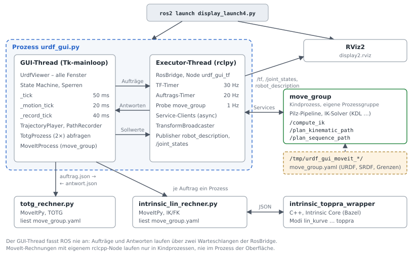
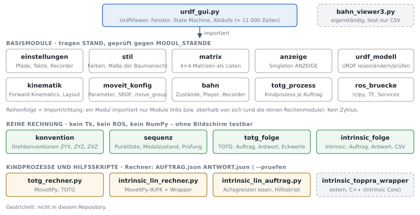
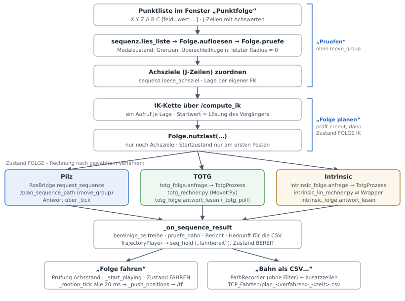

# Teil I · Entwicklerdokumentation {#teil-entwickler .teil .unnumbered}

::: teilkopf
Für Entwicklerinnen und Entwickler, die am Code weiterarbeiten. Vorausgesetzt
werden Python, Grundkenntnisse in ROS 2 und MoveIt 2 sowie Robotik-Grundbegriffe
(Forward und Inverse Kinematics, Time Parameterization). Alle Angaben beziehen
sich auf den Stand im Repository vom Oktober 2026 (`urdf_gui.py` Fassung 2.3).
Abkürzungen und Fachbegriffe erklärt das Verzeichnis vor diesem Teil; die
Installation beschreibt Teil II, Abschnitt 2.
:::

## 1 Zweck und Umfang

Die Software ist eine Tkinter-Oberfläche für ROS 2 (Jazzy) und MoveIt 2. Sie

- lädt eine URDF, zeigt Gelenke, Links und Frames an und lässt das Modell
  bearbeiten (Glieder anhängen, einfügen, herausnehmen, Kopplungen, Aussehen),
- rechnet die Forward Kinematics (FK) selbst und sendet alle Frames auf `/tf`,
  dazu `robot_description` und `/joint_states` (Anzeige in RViz2),
- startet `move_group` als eigenen Kindprozess mit einer selbst erzeugten
  Parameterdatei (URDF, SRDF, Joint Limits, IK-Solver, Pilz-Pipeline),
- plant Einzelfahrten (PTP/LIN mit Pilz) und Punktfolgen mit drei
  vergleichbaren Verfahren – **Pilz**, **TOTG** und **Intrinsic** –,
- tastet die geplanten Bahnen selbst im 20-ms-Takt ab („fährt“ sie also nur
  virtuell über `/tf` und `/joint_states`; es gibt keinen Controller),
- zeichnet die TCP-Bahn mit 25 Hz auf und schreibt sie als CSV.

Ein zweites, eigenständiges Programm, `bahn_viewer3.py`, zeigt aufgezeichnete und
geplante Bahnen in 3D an und vergleicht mehrere Bahnen.

Kommentare, Docstrings, Meldungen und Beschriftungen sind deutsch (ohne
Umlaute); die Bezeichner sind teils deutsch, teils englisch (Abschnitt 1.2).
Docstrings erklären bewusst das *Warum* einer Entscheidung; bei Änderungen
lohnt es sich, sie zu lesen, bevor man eine scheinbar überflüssige Prüfung
entfernt.

### 1.1 Stände der Dateien

Jede Datei, die eine Schnittstelle zu einer anderen hat, trägt eine
Stand-Nummer. Die Oberfläche prüft sie beim Start bzw. beim Auftrag.

| Datei | Konstante | Wert | geprüft durch |
|---|---|---|---|
| `einstellungen`, `moveit_konfig`, `totg_prozess`, `ros_bruecke` | `STAND` | 2 | `urdf_gui.MODUL_STAENDE` / `pruefe_stand()` beim Import, Abbruch bei Abweichung |
| `stil`, `matrix`, `anzeige`, `urdf_modell`, `kinematik`, `bahn` | `STAND` | 1 | ebenso |
| `totg_folge.py` | `STAND` | 2 | `urdf_gui.py` verlangt ≥ 2; geht als `stand` in den TOTG-Auftrag |
| `totg_rechner.py` | `STAND` | 2 | lehnt Aufträge mit höherem `stand` ab |
| `intrinsic_folge.py` | `STAND` / `AUFTRAG_STAND` | 1 / 6 | `urdf_gui.py` verlangt genau 1; `AUFTRAG_STAND` geht in den Auftrag |
| `intrinsic_lin_rechner.py` | `STAND` / `WRAPPER_STAND` | 6 / 3 | lehnt Aufträge mit höherem Stand ab; verlangt Wrapper ≥ 3 |
| `intrinsic_lin_auftrag.py` | `STAND` | 1 | – (Hilfsskript) |

### 1.2 Namen im Code: Deutsch und Englisch

Der Code mischt beide Sprachen, auch innerhalb einer Datei und manchmal
innerhalb eines Namens (`_seq_achsziel_uebernehmen`). Das ist mit den Fassungen
gewachsen: Die älteren Kernteile (Modell, Kinematik, Fahren, ROS, MoveIt) sind
englisch benannt, die später hinzugekommenen Teile (Drehkonvention, Punktfolge,
TOTG, Intrinsic, Kindprozesse) deutsch. Es gibt kein Modul, in dem eine Sprache
die andere vollständig ersetzt hätte. Das Muster:

| Bereich | Sprache | Beispiele |
|---|---|---|
| Kommentare, Docstrings, Meldungen, Beschriftungen | Deutsch, ohne Umlaute | „Uebernehmen“, „Plan verworfen: …“ |
| Dateinamen | Deutsch | `einstellungen.py`, `ros_bruecke.py`, `sequenz.py` |
| ältere Kernteile | Englisch | `UrdfViewer`, `RosBridge`, `MoveItConfig`, `TrajectoryPlayer`, `PathRecorder`, `forward_kinematics`, `append_limb`, `_drive_plan` |
| neuere Teile | Deutsch | `Folge`, `Punkt`, `Befund`, `lies_liste`, `anfrage`, `antwort_lesen`, `TotgProzess.starten`, `Anzeigekonvention.zerlege`, `MoveItKinematik` |
| Namen, die ROS oder MoveIt vorgeben | Englisch, unverändert | `velocity_scaling`, `planner_id`, `blend_radius`, `max_trans_vel`, `path_tolerance`, `resample_dt` |
| Nutzlast an `RosBridge` | Englisch (Felder der ROS-Nachrichten) | `group`, `goal`, `start`, `tolerance` |
| JSON-Schlüssel der Kindprozesse und des Wrappers | Deutsch, außer MoveIt-Namen | `wegpunkte`, `abschnitte`, `umkehr`, `posen`, aber `velocity_scaling` |
| Konstanten | überwiegend Englisch | `IPO_TICK_MS`, `TF_RATE_HZ`; deutsch u. a. `FRIST_S`, `FOLGE_START_TOL`, `MODUL_STAENDE` |
| Zustände | englischer Name, deutscher Wert | `STATE_READY = "BEREIT"`, `STATE_MOVING = "FAHREN"` |
| Methoden von `UrdfViewer` | Englisch; im Bereich Punktfolge auch Deutsch oder gemischt | `_seq_read`, `_totg_send`, `_seq_herkunft_bauen`, `_tick_rumpf` |
| Kopfzeilen der CSV | Deutsch | `#roboter`, `#drehkonvention`, `#verfahren` |

Für Erweiterungen gilt: der Sprache des umgebenden Moduls folgen und Namen, die
ROS oder MoveIt vorgeben, nie übersetzen. Häufige deutsche Namen und ihre
englische Entsprechung:

| Name im Code | englisch | Bedeutung |
|---|---|---|
| `auftrag`, `antwort` | request, response | Daten an einen Kindprozess und sein Ergebnis |
| `Folge`, `Punkt`, `Schritt` | sequence, point, step | Punktfolge, Zeile der Liste, aufgelöste Zeile |
| `Befund` (`fehler`, `warnung`, `hinweis`) | finding | Ergebnis einer Prüfung |
| `nutzlast` | payload | Daten der Anfrage an `/plan_sequence_path` |
| `lage`, `achsziel` | pose, joint goal | Ziel als Lage bzw. als Achswerte |
| `fahrart`, `tempo`, `beschleunigung`, `radius` | motion type, velocity/acceleration scaling, blend radius | Felder der Punktliste |
| `wegpunkte`, `abschnitte`, `teilbahnen`, `umkehr` | waypoints, segments, sub-trajectories, reversal | Aufbau einer Folge |
| `grenzen`, `frist`, `stand` | limits, timeout, version | |
| `herkunft` | provenance | Verfahren und Parameter, die in die CSV geschrieben werden |
| `rechner` | solver | Kindprozess-Skript (`totg_rechner.py`, `intrinsic_lin_rechner.py`) |
| `verschleifen`, `ueberschleifen`, `rundung` | blend, corner rounding | Übergänge an den Ecken |
| `abtastung`, `neuabtastung` | sampling, resampling | |
| `kugel` (`kugeln_pruefen`) | blend sphere | Überschleifkugel um einen Punkt |
| `ecke`, `eckwerte` | corner, corner metrics | Abstand und Geschwindigkeit an einem Zwischenpunkt |
| `ast_folgen` | follow IK branch | Weiterrechnen auf einem anderen IK-Ast |
| `lies_…`, `pruefe_…`, `baue`, `zerlege` | read, check, build, decompose | Verben am Namensanfang |

Eine Vereinheitlichung wäre eine reine Umbenennung, berührt aber die
JSON-Schlüssel (neuer `AUFTRAG_STAND`), die Tests, die `urdf_gui.py` als
Quelltext lesen, und die Kopfzeilen bestehender CSV-Dateien. Sie steht deshalb
als offener Punkt im Ausblick (Teil II, Abschnitt 13).

## 2 Systemumgebung und Start

### 2.1 Voraussetzungen

Die Installation Schritt für Schritt steht in Teil II, Abschnitt 2.

| Komponente | Zweck | Hinweis |
|---|---|---|
| ROS 2 Jazzy, `rclpy`, `tf2_ros` | TF, Topics, Services | ohne ROS startet die GUI trotzdem („Nur Anzeige und FK“) |
| MoveIt 2 mit Pilz-Planner (`moveit_ros_move_group`) | Planung, IK | getestet mit `moveit_core` 2.12.4 |
| `moveit_py` (`ros-jazzy-moveit-py`) | TOTG- und Intrinsic-Rechner | `python3 totg_rechner.py --pruefen` |
| RViz2 | Anzeige | optional (`rviz:=false`) |
| Python 3.12 mit `tkinter`, `PyYAML` | GUI, Parameterdateien | NumPy nur im Intrinsic-Rechner (Singulärwerte) |
| `intrinsic_toppra_wrapper` | Kurve, Resampling, TOPP-RA aus Intrinsic Core | fertig im Projekt (`intrinsic_toppra_wrapper/bin/`), Pfad über `INTRINSIC_WRAPPER`; Selbstbau mit Bazel |
| Pillow (optional) | JPEG/PNG-Export im Bahn-Viewer | sonst PostScript (`.eps`) |

### 2.2 Starten

```bash
source /opt/ros/jazzy/setup.bash
cd ~/Display
ros2 launch display_launch4.py                     # GUI + RViz2
ros2 launch display_launch4.py urdf:=/pfad/robot.urdf
ros2 launch display_launch4.py rviz:=false software_gl:=false
python3 urdf_gui.py [URDF]                         # ohne Launch
python3 bahn_viewer3.py [CSV ...]                  # ohne ROS
```

`display_launch4.py` wird nicht als Package installiert; es löst alle Pfade
relativ zu sich selbst auf und muss neben `urdf_gui.py` liegen.

| Launch-Argument | Standard | Wirkung |
|---|---|---|
| `urdf` | `bmKinematic.urdf` neben dem Skript | geladenes Modell (Argument an `urdf_gui.py`) |
| `rviz` | `true` | RViz2 mit 1,5 s Verzögerung mitstarten |
| `rviz_config` | `display2.rviz` | RViz-Konfiguration |
| `software_gl` | `true` | setzt `LIBGL_ALWAYS_SOFTWARE=1` (unter WSL nötig) |
| `intrinsic_wrapper` | `$INTRINSIC_WRAPPER` oder `~/intrinsic-core/bazel-bin/intrinsic_toppra_wrapper/intrinsic_toppra_wrapper` | wird als Umgebungsvariable `INTRINSIC_WRAPPER` an die GUI gereicht |

Die GUI läuft als `ExecuteProcess` mit `on_exit=Shutdown`: Schließt man das
Fenster, endet das gesamte Launch. Ohne URDF-Argument gilt `URDF_PATH` aus
`einstellungen.py`, also `bmKinematic.urdf` neben den Skripten.

| Umgebungsvariable | Wirkung |
|---|---|
| `INTRINSIC_WRAPPER` | Pfad zum Intrinsic-Wrapper (setzt auch das Launch-Argument) |
| `URDF_GUI_URDF` | URDF ohne Startargument |
| `URDF_GUI_SICHERUNG` | Ablage für Sicherungen der URDF |
| `URDF_GUI_BAHNEN` | Ablage für CSV-Bahnen |
| `LIBGL_ALWAYS_SOFTWARE` | Software-Rendering für RViz (über `software_gl`) |

## 3 Architektur

### 3.1 Prozesse und Threads

{width=100%}

Zur Laufzeit gibt es bis zu fünf Arten von Prozessen:

1. **`urdf_gui.py`** – ein Prozess mit zwei Threads:
   - *GUI-Thread* (Tk-`mainloop`): alle Fenster, die State Machine, die
     Interpolation der Bahn, der Recorder. Er fasst ROS **nie** an.
   - *Executor-Thread* der `RosBridge`: ein `SingleThreadedExecutor` mit drei
     Timern (TF 30 Hz, Aufträge 20 Hz, Probe 1 Hz) in einer eigenen
     `spin_once`-Schleife, die Exceptions fängt, statt zu sterben.
2. **`move_group`** – gestartet von `MoveItProcess` als Kindprozess in eigener
   Prozessgruppe, mit eindeutigem Node-Namen `move_group_gui<PID>_<n>`.
3. **`totg_rechner.py` / `intrinsic_lin_rechner.py`** – je Auftrag ein kurzer
   Kindprozess (über `TotgProzess`), weil `moveit_py` einen eigenen
   rclcpp-Node mitbringt, der nicht in den GUI-Prozess gehört.
4. **`intrinsic_toppra_wrapper`** – C++-Programm aus Intrinsic Core, je
   Rechenschritt einmal vom Intrinsic-Rechner aufgerufen.
5. **RViz2** – reiner Anzeiger.

### 3.2 Schichten und Module

{width=100%}

| Datei | Verantwortung | wichtigste Namen |
|---|---|---|
| `urdf_gui.py` | Oberfläche, Ablaufsteuerung, alle Fenster | `UrdfViewer`, `MODUL_STAENDE`, `pruefe_stand()`, `main()` |
| `einstellungen.py` | Pfade, Takte, Grenzen des Recorders | `HIER`, `URDF_PATH`, `BACKUP_DIR`, `BAHN_DIR`, `BAHN_VIEWER`, `TF_RATE_HZ`, `RECORD_*` |
| `stil.py` | Farbpalette, Maße der Baumansicht | `BG`, `ACCENT`, `COLOR_*`, `TREE_*` |
| `matrix.py` | 4×4-Matrizen als Listen (ohne NumPy) | `multiply`, `invert`, `from_axis_angle`, `to_quaternion` |
| `konvention.py` | Drehkonventionen ZYX, ZYZ, ZXZ (intrinsisch) | `from_abc_xyz`, `to_xyz_abc`, `from_rpy_xyz`, `to_xyz_rpy`, `ist_singulaer` |
| `anzeige.py` | gewählte Anzeigekonvention, Singleton | `Anzeigekonvention`, `ANZEIGE` |
| `urdf_modell.py` | URDF lesen, ändern, prüfen, speichern | `parse`, `validate_root`, `append_limb`, `insert_limb`, `remove_limb`, `save_urdf` |
| `kinematik.py` | Forward Kinematics, Layout des Gelenkbaums | `forward_kinematics`, `root_links`, `leaf_links`, `tree_layout` |
| `moveit_konfig.py` | Konfiguration, SRDF, Parameterdatei, `move_group`-Prozess | `MoveItConfig`, `MoveItProcess`, `build_srdf` |
| `bahn.py` | Zustände, Interpolation, Abtaster, Recorder | `TrajectoryPlayer`, `PathRecorder`, `hermite`, `STATE_*` |
| `totg_prozess.py` | Rechner als kurzer Kindprozess | `TotgProzess` |
| `ros_bruecke.py` | rclpy-Node, TF, Service-Aufrufe | `RosBridge` |
| `sequenz.py` | Punktliste, Modalzustand, Prüfung, Nutzlast | `lies_liste`, `Folge`, `Punkt`, `Befund`, `loese_achsziel` |
| `totg_folge.py` | TOTG-Auftrag, Antwort, Eckwerte, CSV-Kopf | `anfrage`, `antwort_lesen`, `abschnitte`, `eckwerte` |
| `intrinsic_folge.py` | Intrinsic-Auftrag, Antwort, CSV-Kopf | `anfrage`, `antwort_lesen`, `pruefe_parameter` |
| `totg_rechner.py` | TOTG über `moveit_py` (Kindprozess) | `rechne`, `params_fuer_moveitpy`, `verketten` |
| `intrinsic_lin_rechner.py` | LIN/PTP nach Intrinsic Core mit MoveIt-IK (Kindprozess) | `rechne`, `MoveItKinematik`, `ik_kette`, `tcp_pruefung` |
| `intrinsic_lin_auftrag.py` | Joint Limits aus der Parameterdatei; Hilfsskript TOTG→LIN-Auftrag | `parameter_lesen`, `grenzen_lesen` |
| `bahn_viewer3.py` | 3D-Bahnansicht, eigenständig | `BahnViewer`, `Track`, `Camera` |

Abhängigkeiten laufen nur in eine Richtung: Die Basismodule bilden eine Kette
`einstellungen → stil → matrix → anzeige → urdf_modell → kinematik →
moveit_konfig → bahn → totg_prozess → ros_bruecke`, in der jedes Modul nur
Vorgänger und die reinen Rechenmodule importiert. `urdf_gui.py` importiert alles,
importiert wird es von niemandem (die Tests lesen es als Text, siehe
Abschnitt 8).

### 3.3 Leitlinien im Code

Diese Regeln ziehen sich durch alle Module. Wer sie bricht, bekommt Fehler, die
schwer zu finden sind.

**Ein Thread fasst ROS an.** Der GUI-Thread baut keine ROS-Nachrichten und
wartet nie auf eine Antwort. Er legt Aufträge als reine Python-Daten
(`dict` aus Zahlen und Zeichenketten) in `RosBridge._jobs` ab; der
Executor-Thread baut daraus die Nachricht und legt die Antwort, wieder als
reine Daten, in `RosBridge.results` ab. Abgeholt wird im Fußzeilentakt
(`_tick`, 50 ms). Einzige Ausnahme ist `set_positions()`, das unter einem Lock
die Sollwerte übergibt.

**Jede Antwort trägt einen Tag.** `_job_open()` vergibt die Auftragsnummer `tag`,
`_job_mine()` lässt nur die erwartete Antwort durch, `_job_drop()` verwirft
alles Ausstehende. So kann eine verspätete Antwort eines abgebrochenen
Auftrags nie als neue gelten.

**MoveIt-Rechnungen mit eigenem Node laufen im Kindprozess.** `moveit_py`
bringt eine eigene rclcpp-Laufzeit mit. Deshalb laufen TOTG und die
Intrinsic-IK in `totg_rechner.py` bzw. `intrinsic_lin_rechner.py`, nie im
GUI-Prozess.

**Eine Kinematik für die Planung.** Die Inverse Kinematics (IK) kommt
ausschließlich aus MoveIt (`/compute_ik` bzw. `moveit_py` mit derselben
Parameterdatei wie `move_group`). Die GUI rechnet die Forward Kinematics (FK)
für Anzeige, TF und Aufzeichnung selbst aus der URDF
(`kinematik.forward_kinematics`); die Rechner nutzen für ihre FK wieder MoveIt.

**Nichts wird still korrigiert.** Begrenzte Werte werden gelb gefärbt und
gemeldet, verworfene Stützpunkte gezählt, Abweichungen stehen im Bericht und als
`#`-Zeile in der CSV.

**Takte planen sich im `finally` neu.** `_tick` und `_record_tick` fangen jede
Exception, melden sie und bestellen den nächsten Durchlauf im `finally`. Eine
Exception kostet so einen Takt, nie den Takt. Dasselbe gilt im Executor-Thread
über `RosBridge._guard()`.

**Eine Stelle je Zuständigkeit.** Zustand nur über `_set_state()`, Sperren nur
über `_update_locks()`, Achswerte hinaus nur über `_push_positions()`,
Modelländerungen nur über `_commit()`, Fahrten nur über `_start_playing()`.

**Radius 0 heißt Genauhalt** – in allen drei Verfahren.

### 3.4 State Machine

{width=100%}

Die Zustände stehen als Zeichenketten in `bahn.py` (`BEREIT`, `IK`, `PLANEN`,
`FOLGE IK`, `FOLGE`, `FAHREN`, `BREMSEN`, `FEHLER`). `UrdfViewer._set_state()`
ist der einzige Weg, den Zustand zu wechseln; es setzt `lock_reason` für alle
Zustände in `STATES_BUSY` und ruft `_update_locks()`, die einzige Stelle, an
der Bedienelemente aktiviert oder gesperrt werden. Daneben gibt es zwei
weitere Sperrgründe: STOP (`self.stopped`, sperrt Sollwerte) und den Hochlauf
von `move_group` (`lock_reason = "Neustart move_group"`).

`_brake(why)` ist die einzige Bremse. Je nach Zustand verwirft sie eine laufende
IK, Planung, IK-Kette oder Kindprozess-Rechnung oder leitet beim Fahren die
Bremsrampe ein (`TrajectoryPlayer.brake()`, Zeitrate in `BRAKE_TIME_S` = 0,4 s
linear auf null). Sie stoppt zugleich das Joggen und lässt den Halte-Taster
fallen.

### 3.5 Takte und Timer

| Takt | Ort | Periode | Aufgabe |
|---|---|---|---|
| `_tick` | GUI-Thread (`after`) | `FOOTER_TICK_MS` = 50 ms | Fußzeile, Ergebnisse von `RosBridge` abholen, Kindprozesse abfragen (`_totg_poll`, `_intrinsic_poll`), Watchdogs für `move_group` und TF |
| `_motion_tick` | GUI-Thread | `IPO_TICK_MS` = 20 ms | einen Interpolationsschritt fahren |
| `_record_tick` | GUI-Thread | `RECORD_TICK_MS` = 40 ms (25 Hz) | Bahnpunkt anbieten |
| `_jogj_step` | GUI-Thread | `JOG_TICK_MS` = 50 ms | Achs-Dauerjoggen |
| `_hold_watch` | GUI-Thread | `HOLD_WATCH_MS` = 100 ms | Watchdog am Halte-Taster |
| TF-Timer | Executor | 1/`TF_RATE_HZ` = 33 ms | `/tf` und `/joint_states` senden |
| Auftrags-Timer | Executor | 1/`JOB_RATE_HZ` = 50 ms | einen Auftrag stellen, Timeouts prüfen |
| Probe | Executor | 1 s | eigenen `move_group` und seine Services im Graphen suchen |

Die Bahnzeit des `TrajectoryPlayer` entsteht aus der Summe der Takte
(`ticks × dt`), nicht aus der Wall-Clock-Zeit. Dadurch ist dieselbe Bahn
reproduzierbar; die Abweichung zur Wall-Clock-Zeit wird am Ende jeder Fahrt
gemeldet (Meldung „Wanduhr“).

## 4 Module im Einzelnen

Die folgenden Abschnitte nennen die öffentliche Schnittstelle jedes Moduls, also
das, was andere Module aufrufen. Private Helfer (`_…`) sind weggelassen.

### 4.1 `einstellungen`, `stil`

Reine Konstanten. `einstellungen.py` enthält die Pfade, die TF-Rate,
Recorder-Schwellen und Slider-Spannen; `stil.py` Farben und die Maße der
Baumansicht. Vollständige Liste in Anhang A.

Seit Stand 2 stehen in `einstellungen.py` keine absoluten Pfade mehr. `HIER`
ist der Ordner des Moduls; `URDF_PATH` (`bmKinematic.urdf`), `BACKUP_DIR`
(`URDF_Speicher/`) und `BAHN_DIR` (`TCP_Fahrten/`) hängen daran und lassen
sich über `URDF_GUI_URDF`, `URDF_GUI_SICHERUNG` und `URDF_GUI_BAHNEN`
umlenken (eine leere Variable zählt als nicht gesetzt, `~` wird aufgelöst).
`BAHN_VIEWER` nennt die Bahnansicht, auf die die GUI nach einem Export
verweist.

### 4.2 `matrix`, `konvention`, `anzeige`

`matrix.py` arbeitet mit 4×4-Matrizen als Liste von Zeilen, bewusst ohne NumPy
(feste Summationsreihenfolge, reproduzierbar): `identity()`, `multiply(a, b)`,
`from_rpy_xyz(rpy, xyz)`, `from_axis_angle(axis, angle)` (Rodrigues),
`from_translation(xyz)`, `invert(m)` (orthonormaler Sonderfall),
`to_xyz_rpy(m)`, `to_quaternion(m)` (Shepperd, Rückgabe `x, y, z, w`).

`konvention.py` hält die drei Drehkonventionen für die Winkel A, B, C. Alle sind
intrinsisch: `R = R_a1(A) · R_a2(B) · R_a3(C)`.

| Konvention | Achsen A, B, C | Bereich B | entartet bei B = |
|---|---|---|---|
| `ZYX` (Standard, Kardan, = URDF-rpy) | Z, Y, X | −90° … 90° | ±90° |
| `ZYZ` (Euler) | Z, Y, Z | 0° … 180° | 0°, 180° |
| `ZXZ` (Euler) | Z, X, Z | 0° … 180° | 0°, 180° |

Schnittstelle: `pruefe(name)`, `from_abc_xyz(abc, xyz, konvention)`,
`to_xyz_abc(m, konvention)`, `from_rpy_xyz` / `to_xyz_rpy` (Brücke zur URDF,
immer ZYX mit `(roll, pitch, yaw) = (C, B, A)`), `singularitaetsabstand`,
`ist_singulaer`, `kennung` / `lies_kennung` (Kopfzeile `drehkonvention=…`),
`spaltennamen(praefix, konvention)` (z. B. `a_z_deg, b_y_deg, c_x_deg`).

`anzeige.ANZEIGE` ist das einzige Exemplar von `Anzeigekonvention`. Wer etwas
anzeigt, ruft `zerlege(matrix)`; wer eine Eingabe weiterreicht, ruft
`baue(abc, xyz)`. `setzen(name)` schaltet um und ruft alle mit `melden()`
eingetragenen Callbacks; `sperren(grund)` / `freigeben()` verhindern das
Umschalten (genutzt während einer Aufzeichnung). In die URDF wird immer ZYX
geschrieben – die Einstellung betrifft nur Anzeige und Eingabefelder.

### 4.3 `urdf_modell`

Arbeitet auf einem `xml.etree.ElementTree`-Baum (`xml_root`), der in der GUI
die einzige Wahrheit über das Modell ist.

| Funktion | Zweck |
|---|---|
| `parse(path)` → `(root, name, links, joints, xml)` | Datei lesen; `links`/`joints` sind Listen von `dict` (siehe unten) |
| `parse_root(root)` → `(name, links, joints)` | dasselbe aus einem Baum |
| `serialize(root)` | eingerückter XML-Text |
| `validate_root(root)` → `[Fehlertext]` | Namen, Typen, Eltern, genau ein Root-Link, Kreise, Grenzen, Achsen, Kopplungen |
| `append_limb(root, link, joint, jtype, parent, xyz, rpy, axis, lower, upper)` | Glied an einen Link anhängen |
| `insert_limb(root, link, joint, jtype, below, xyz, rpy, axis, lower, upper, keep_pose)` | Glied vor dem Gelenk `below` einfügen |
| `insert_above_root(root, link, joint, xyz, rpy)` | neuen Basisframe über den Root-Link setzen |
| `remove_limb(root, joint, keep_pose)` | Glied herausnehmen, Nachfolger rücken auf |
| `remove_branch(root, link_names)` | Teilbaum löschen |
| `rename_link`, `rename_joint` | umbenennen mit allen Verweisen (auch `<mimic>`) |
| `set_axis`, `set_limit`, `set_mimic`, `clear_mimic`, `set_visual` | Einzelattribute setzen |
| `coupling_problem(joints, name, source)` | Kopplung prüfen (keine Ketten, keine festen Gelenke) |
| `apply_couplings(joints, positions)` | Werte gekoppelter Gelenke eintragen (`faktor · führung + versatz`, begrenzt) |
| `slider_range`, `slider_step`, `snap`, `value_digits`, `limit_digits` | Slider und Anzeigegenauigkeit |
| `save_urdf(path, xml)` → Sicherungspfad | atomar schreiben; vorhandene Datei vorher mit Zeitstempel nach `BACKUP_DIR` kopieren |
| `backup_dir_for(path)`, `bahn_dir_for(path)`, `timestamped_name(path)` | Ablageorte |

Ein Gelenk-`dict` enthält `name, type, parent, child, xyz, rpy, origin (4×4),
quat, axis (normiert), lower, upper, effort, velocity, has_limit, mimic`
(`None` oder `{"joint", "multiplier", "offset"}`). Ein Link-`dict` enthält
`name, mass, com, has_inertial, visual`. `<origin>` wird mit 10 Stellen
geschrieben (`ORIGIN_DIGITS`), damit Umrechnungen beim Einfügen und Herausnehmen
nicht als Lagefehler akkumulieren.

### 4.4 `kinematik`

`forward_kinematics(links, joints, positions)` → `{link: 4×4}` relativ zur
ersten Root-Link; nicht erreichbare Teilbäume fehlen im Ergebnis.
`local_transform(joint, value)` gibt Eltern→Kind bei Gelenkwert zurück (auch
von `RosBridge` für `/tf` benutzt). `root_links`, `leaf_links` (TCP-Kandidaten)
und `tree_layout` (Zwei-Pass-Layout für die Baumansicht) ergänzen das Modul.

### 4.5 `moveit_konfig`

**`MoveItConfig`** hält alle Werte für `move_group`, getrennt nach Wirkung:

| Attribut | Inhalt | wirkt |
|---|---|---|
| `plan`, `planner_id` | Felder aus `PLAN_FIELDS` (Overrides in %, Planungszeit, Versuche, Achs-Zieltoleranz in Grad, Überschleifradius) und Fahrart | je Auftrag, sofort |
| `limits` | `{gelenk: {velocity, acceleration, deceleration, jerk}}`, `None` = Grenze aus | nach Neustart |
| `cartesian` | `max_trans_vel`, `max_trans_acc`, `max_trans_dec`, `max_rot_vel` | nach Neustart |
| `planner` | `sampling_time` (nur mit gepatchtem Pilz) | nach Neustart |
| `solver`, `kinematics`, `kdl`, `kdl_position_only` | IK-Solver und Parameter | nach Neustart |
| `group`, `tip` | Planning Group (`manipulator`), Tip-Link (leer = einziger Leaf-Link) | nach Neustart |
| `use_ruckig`, `check_collisions`, `allow_execution` | Adapter der Pipeline | nach Neustart |

Wichtige Methoden: `sync_joints(joints)` (Grenzen an das Modell anpassen,
fehlende aus der URDF ableiten: a = 2·v, Jerk = 10·a), `params_yaml(urdf, srdf)`
(vollständige Parameterdatei, Abschnitt 5.3), `startup_signature()` (Text aller
neustartpflichtigen Werte; ändert er sich, ist `move_group` „veraltet“).

**`build_srdf(name, links, joints, group, tip)`** erzeugt die SRDF neu aus dem
Modell: eine Planning Group als Kette Root-Link→Tip, ein `group_state` „null“, und
`disable_collisions` für jedes benachbarte Linkpaar.

**`MoveItProcess`** startet und beendet `move_group`. `start(config, urdf, srdf)`
schreibt `move_group.yaml`, `robot.urdf`, `robot.srdf` in einen neuen Ordner
`/tmp/urdf_gui_moveit_*`, sucht das Binary über `AMENT_PREFIX_PATH`
(Rückfall: `ros2 run`) und startet mit `--params-file` und eindeutigem
Node-Namen. Ausgabe nach `move_group.log`. `stop()` signalisiert die ganze
Prozessgruppe (SIGINT 3 s → SIGTERM 3 s → SIGKILL 2 s). `state()` liefert
`aus | startet | laeuft | beendet | fehler`; `strays()` / `kill_strays()` finden
bzw. beenden fremde `move_group` über `/proc`; `sweep_workdirs()` räumt alte
Arbeitsordner (beim GUI-Start alles älter als 1 h).

### 4.6 `bahn`

- **Zustände** `STATE_*`, `STATES_BUSY`; Zielräume `SPACE_JOINT`, `SPACE_CART`.
- **`moveit_error_text(code)`** übersetzt `MoveItErrorCodes` in einen Satz mit
  Hinweis (Tabelle in Teil II, Abschnitt 11.1).
- **`hermite(p0, v0, p1, v1, span, s)`** – kubische Hermite-Interpolation; nutzt
  die von Pilz/TOTG gelieferten Geschwindigkeiten, damit die Geschwindigkeit an
  den Stützpunkten stetig bleibt.
- **`TrajectoryPlayer(points, dt=IPO_DT)`** mit `points = [(t, {name: pos},
  {name: vel}), …]`: `step()` → Sollwerte nach einem Takt, `sample(t)`,
  `brake()`, Eigenschaften `done`, `stopped`, `progress`, `wall_drift(elapsed)`.
- **`bahn_startabweichung(punkte, stand)`** → `(achse, betrag, fehlende_achsen)`
  – vergleicht den ersten Stützpunkt mit dem Achsstand (Prüfung vor jeder
  Folgenfahrt mit `FOLGE_START_TOL` = 1e-4 rad).
- **`PathRecorder`** – Ringpuffer (max. 20 000 Punkte) für die TCP-Bahn.
  `start(joint_names, frame_names, chain, couplings, robot_name,
  joint_tolerances, drehkonvention)`, `sample(xyz, abc, values, frames, now)`
  (filtert Stillstand nach Weg, Drehung und Achsänderung), `stop()`, `clear()`,
  `reset()`, `header()`, `write_csv(path, zusatz=())`.

### 4.7 `ros_bruecke.RosBridge`

| Methode | Thread | Zweck |
|---|---|---|
| `start()` → `None` oder Meldung | GUI | rclpy initialisieren, Node `urdf_gui_tf`, Publisher, Timer, Executor-Thread starten; importiert ROS erst hier |
| `shutdown()` | GUI | Thread beenden, Node zerstören |
| `set_model(joints, urdf_xml)` | GUI | `robot_description` senden, Liste der TF-Gelenke setzen, einmal sofort senden |
| `set_positions(positions)` | GUI | Sollwerte übergeben (Lock) |
| `request_plan(payload)`, `request_ik(payload)`, `request_sequence(payload)` | GUI | Auftrag ablegen (siehe 5.2) |
| `reset_moveit(node_name)` | GUI | nach Start/Stopp von `move_group`: Clients verwerfen, erwarteten Node-Namen setzen |
| `take_results()` → `[(art, wert)]` | GUI | Ergebnisse in einem Zug abholen |
| `running`, `thread_alive()`, `moveit_ready`, `sequence_ready`, `last_publish`, `cycle_ms`, `enabled` | GUI (lesend) | Zustand für Anzeige und Sperren |

Pro Zeitpunkt ist höchstens **ein** Service-Aufruf offen (`_pending`); er endet
spätestens nach dem mitgegebenen Timeout (`timeout`) mit einer Fehlermeldung.

### 4.8 `totg_prozess.TotgProzess`

Generischer Starter für einen Rechner-Kindprozess; die GUI hält zwei Exemplare
(`self.totg` mit `totg_rechner.py`, `self.intrinsic` mit
`intrinsic_lin_rechner.py`).

| Methode | Zweck |
|---|---|
| `TotgProzess(rechner=TOTG_RECHNER)` | Pfad zum Rechnerskript |
| `starten(auftrag, tag, frist)` → `None` oder Meldung | Ordner `/tmp/urdf_gui_totg_*` anlegen, `auftrag.json` schreiben, Prozess starten (eigene Session, Ausgabe nach `totg.log`) |
| `abfragen()` | `None` solange er läuft; sonst `{"tag", "text", "dauer"}` oder `{"tag", "error"}` (auch bei Timeout) |
| `protokoll(lines)` | letzte Zeilen von `totg.log` |
| `abbrechen()` | Prozessgruppe beenden (SIGTERM, dann SIGKILL), Ordner bleibt |
| `aufraeumen()` | beenden und Ordner löschen |
| `laeuft` | läuft ein Prozess? |

### 4.9 `sequenz`

Liest und prüft Punktlisten; keine Oberfläche, kein ROS.

- `lies_liste(text)` → `(punkte, befunde)`; `lies_zeile(text)` → `Punkt`
  (Format in Abschnitt 5.8).
- `Punkt(xyz, abc, achsen, name, fahrart, tempo, beschleunigung, radius,
  hilfspunkt, achsziel)`; `ergaenze_lage(xyz, abc)` nur bei Achszielen.
- `Folge(punkte, modal)`: `aufloesen()` → Tupel von `Schritt` mit `herkunft` je
  Feld (`zeile`, `modal`, `achsziel`); `pruefe(schritte, kugeln_pruefen)` →
  Tupel von `Befund`; `fehler()`, `tragfaehig()`; `nutzlast(gruppe, start,
  toleranz, planungszeit, versuche, tag, kugeln_pruefen)` → Auftrag für
  `/plan_sequence_path` (Abschnitt 5.2); jeder Punkt muss dafür Achswerte
  tragen, eine Lage ohne Achswerte ist ein `ValueError`; `bericht()`,
  `spielraum()`, `endzustand()`.
- `Befund(stufe, text, stelle, paar)` mit den Stufen `fehler` (hält an),
  `warnung`, `hinweis`.
- `loese_achsziel(punkt, gelenke, index)` ordnet die Werte einer J-Zeile den
  Gelenken zu und prüft Anzahl und Grenzen (ohne Begrenzung).
- `bereinige_zeitreihe(punkte)` entfernt Stützpunkte ohne wachsende Zeit
  (bekanntes Verhalten beim Überschleifen in MoveIt), `pruefe_bahn(punkte)`
  liefert Befunde zur Antwort.

### 4.10 `totg_folge`

- `pruefe_parameter(path_tolerance, resample_dt)`.
- `anfrage(nutzlast, gelenke, drehend, params_datei, path_tolerance,
  resample_dt, min_angle_change)` → `(auftrag, befunde)`; baut aus der Nutzlast
  eine Polylinie im Joint Space, zerlegt sie an Genauhalten (Radius 0) und
  Umkehrpunkten (`abschnitte`, `ist_umkehr` – gleiche Regel wie `Path::create`
  in MoveIt), meldet verworfene Punkte (`doppelte_punkte`) und lehnt
  wechselnde Overrides ab.
- `auftrag_text(auftrag)`, `antwort_lesen(text, gelenke)` → Ergebnis in
  derselben Form wie `RosBridge._read_sequence` plus Block `totg`.
- `endabweichung(punkte, auftrag)`, `eckwerte(zeiten, orte, ecken)` (kleinster
  Abstand der TCP-Bahn zu jeder Ecke und Geschwindigkeit dort),
  `zusatzzeilen(herkunft)` (Kommentarzeilen für die CSV).

### 4.11 `intrinsic_folge`

- `wrapper_pfad()` – `$INTRINSIC_WRAPPER` oder `WRAPPER_STANDARD`.
- `pruefe_parameter(rundung_rot, resample_dt, ueberschleifen_rad,
  gelenk_abtastung_rad, tcp_v_max, tcp_a_max)`; `bahngrenze_lesen(roh)`
  (leer → `None`).
- `anfrage(nutzlast, gelenke, params_datei, tip, rundung_rot, resample_dt,
  wrapper, grenzen_lesen, ueberschleifen_rad, gelenk_abtastung_rad, tcp_v_max,
  tcp_a_max)` → `(auftrag, befunde)`. Regeln: nur LIN und PTP; ein Override für
  die ganze Bahn; zwischen zwei LIN-Zeilen ein einziger Radius > 0 für die ganze
  Kurve; Abschnittsgrenzen an Genauhalt, Umkehr und Wechsel der Fahrart; ein
  Wechsel mit Radius > 0 wird im Joint Space überschliffen (`verschleifen`).
  Joint Limits kommen über `intrinsic_lin_auftrag.grenzen_lesen` aus der
  Parameterdatei von `move_group` (Beschleunigungsgrenze ist Pflicht).
- `antwort_lesen(text, gelenke)` – Grundgerüst über
  `totg_folge.antwort_lesen`, dazu Block `intrinsic` mit Kennwerten.
- `zusatzzeilen(herkunft)` – TOTG-Zeilen plus Intrinsic-Schlüssel
  (`ZUSATZ_SCHLUESSEL`).

### 4.12 Rechner-Kindprozesse

**`totg_rechner.py`** liest den Auftrag, schreibt die Parameterdatei für
MoveItPy um (`params_fuer_moveitpy`: `planning_pipelines` als
`pipeline_names`, eigener Name für den Planning Scene Monitor), startet `MoveItPy`, ruft
je Abschnitt `apply_totg_time_parameterization` und hängt die Abschnitte an
(`verketten`).

**`intrinsic_lin_rechner.py`** bildet den LIN-Planner von Intrinsic Core nach,
mit IK aus MoveIt. Je LIN-Abschnitt:

1. FK der Wegpunkte → Posen des Tip-Links (MoveIt),
2. Wrapper `lin_kurve`: verrundete kartesische Kurve, gleichmäßig abgetastet,
3. IK-Kette an allen Kurvenposen, Startwert jeweils die vorige Lösung,
4. Wrapper `lin_neuabtastung` (Resampling): Kurvenparameter, gleichabständig im Joint Space,
5. IK-Kette an den dichten Posen; behalten werden die vom Wrapper genannten
   Indizes.

PTP-Abschnitte gehen ohne IK als Gelenkpfad weiter. Danach (optional
`toppra_proben` + TCP-Ableitungen per MoveIt-FK für `tcp_v_max`/`tcp_a_max`)
rechnet der Wrapper im Modus `toppra` die Time Parameterization über alle
Teilpfade. Prüfungen nach Intrinsic (`MAX_IK_SPRUNG_RAD` = π/4,
`START_TOLERANZ_RAD`, `ZIEL_TOLERANZ_RAD`) und eine eigene (FK der IK-Lösung
muss die Pose auf 1 mm / 0,01 rad treffen) führen zum Abbruch, nie zur
Korrektur. Mit `ast_folgen` (Standard an) wird eine LIN-Kette, die die Zielpose
auf einem anderen IK-Ast erreicht, fortgesetzt und im Bericht gemeldet.

Beide Rechner schreiben die Antwort atomar (Zwischendatei + `os.replace`) und
beenden sich mit `os._exit`, weil MoveItPy beim normalen Ende hängen kann.

**`intrinsic_lin_auftrag.py`** liefert `parameter_lesen(pfad)`,
`grenzen_lesen(params, gelenke)` (Positionsgrenzen aus der URDF, v/a aus
`robot_description_planning.joint_limits`; `continuous` → ±1e9) und
`tip_aus_srdf`. Als Skript macht es aus einem TOTG-Auftrag einen LIN-Auftrag
(`--wrapper`, `--tip`, `--rundung-t`, `--rundung-r`).

### 4.13 `urdf_gui.UrdfViewer`

Die Klasse erbt von `tk.Tk` und ist nach Themen gegliedert (Abschnitte durch
Kommentarbalken getrennt):

| Bereich | Einstieg | Inhalt |
|---|---|---|
| Aufbau Hauptfenster | `_build_ui`, `_build_head`, `_build_body`, `_build_foot` | Karten, Tabellen, Reiter |
| Meldungen, STOP | `_log`, `_toggle_stop` | Meldungsfenster (max. 600 Zeilen), STOP/FREI |
| Fahrfenster | `_open_drive`, `_build_drive_*`, `_drive_param_commit` | Zielfelder, Fahrparameter, Auftragstasten |
| Sperren, Zustand | `_lock`, `_update_locks`, `_set_state`, `_job_*` | siehe 3.3/3.4 |
| Einzelauftrag | `_drive_plan`, `_plan_joint_goal`, `_on_plan_result`, `_ik_request`, `_on_ik_result` | Planen über Pilz, IK über `/compute_ik` |
| Joggen | `_jog_press/_jog_step/_on_jog_result`, `_jogj_*` | kartesisch über IK, Achse direkt |
| Fahren | `_drive_start`, `_start_playing`, `_motion_tick`, `_finish_playing`, `_brake` | Abtasten im 20-ms-Takt |
| Halte-Taster | `_hold_press`, `_hold_release`, `_hold_watch`, `_hold_launch` | planen und fahren, solange gedrückt |
| `move_group` | `_moveit_start`, `_moveit_stop`, `_moveit_watch`, `_moveit_stale` | Kindprozess und Watchdog |
| Parameterfenster | `_open_params`, `_build_param_*`, `_params_apply`, `_params_restart` | sechs Reiter |
| Laden/Speichern | `_load`, `_save`, `_save_as`, `_discard` | Datei und Sicherung |
| Verlauf | `_commit`, `_undo`, `_push_history` | einzige Änderungsstelle, 25 Schritte zurück |
| Sollwerte | `_apply`, `_on_slider`, `_push_positions` | direkt stellen ohne MoveIt |
| Recorder | `_toggle_record`, `_record_tick`, `_export_record` | Aufzeichnung und CSV |
| Punktfolge | `_open_sequence`, `_seq_read`, `_seq_plan`, `_seq_ik_next`, `_seq_send`, `_totg_send`, `_intrinsic_send`, `_on_sequence_result`, `_seq_drive`, `_seq_export` | siehe 6.6 |
| Kinematik-Anzeige | `_tcp_link`, `_tcp_pose`, `_pose_text`, `_update_kinematics` | TCP-Zeile, Frametabelle |
| Editor | `_open_editor`, `_build_tree_panel`, `_draw_tree`, `_edit_apply`, `_open_add/insert/remove/frame_window`, `_build_visual_tab` | Bearbeiten-Fenster |
| Takt | `_tick`, `_tick_rumpf`, `_on_close` | Fußzeile, Ergebnisse, Aufräumen |

Der aktive TCP (`_tcp_link`) ist `moveit_config.tip`, falls gesetzt und
vorhanden, sonst der einzige Leaf-Link außer dem Root-Link; bei mehreren
Leaf-Links ohne Wahl gibt es keinen TCP (Anzeige und Recorder melden das).

### 4.14 `bahn_viewer3`

Eigenständige Tk-Anwendung `BahnViewer` ohne ROS und ohne URDF. `Track.load(path)`
liest eine CSV (alte Spalten `roll/pitch/yaw` und neue `a_*/b_*/c_*`), bestimmt
die Drehkonvention aus `#drehkonvention` und den Spaltennamen und bricht bei
Widerspruch ab. Gezeichnet wird mit eigener orthographischer Projektion
(`Camera`) auf einer Tk-Canvas, ohne OpenGL. Mehrere Bahnen lassen sich
gleichzeitig laden; die aktive gibt den Takt vor, die Marker der anderen laufen
zur gleichen Zeit seit Bahnbeginn mit. `--pruefen datei.csv …` liest nur ein und
berichtet.

## 5 Schnittstellen

### 5.1 ROS 2

| Richtung | Name | Typ | Einzelheiten |
|---|---|---|---|
| Publisher | `/tf` | `tf2_msgs/TFMessage` (`TransformBroadcaster`) | alle Gelenke mit Eltern und Kind, **auch feste** (bewusst nicht `/tf_static`), 30 Hz, gemeinsamer Zeitstempel |
| Publisher | `robot_description` | `std_msgs/String` | QoS: depth 1, reliable, transient local; bei jedem Modellwechsel |
| Publisher | `/joint_states` | `sensor_msgs/JointState` | alle beweglichen Gelenke inkl. gekoppelter, nur `position`, im TF-Takt |
| Client | `/plan_kinematic_path` | `moveit_msgs/GetMotionPlan` | Einzelauftrag, Pipeline `pilz_industrial_motion_planner`, Achsziele als `JointConstraint` |
| Client | `/compute_ik` | `moveit_msgs/GetPositionIK` | Lage im Frame des Root-Links, Startwert = Achsstand bzw. Vorgänger, `avoid_collisions` = Kollisionsprüfung |
| Client | `/plan_sequence_path` | `moveit_msgs/GetMotionSequence` | Punktfolge (Pilz), Capability `MoveGroupSequenceService` |

Node-Namen: GUI `urdf_gui_tf`, `move_group` als
`move_group_gui<PID>_<laufende Nummer>`, Rechner `urdf_gui_totg_<PID>` bzw.
`urdf_gui_intrinsic_lin_<PID>`. Die Probe hält `moveit_ready` für wahr, wenn die
eigene Node im Graphen steht und `/plan_kinematic_path` sowie `/compute_ik`
angeboten werden; `sequence_ready` zusätzlich bei `/plan_sequence_path`.

### 5.2 GUI ↔ `RosBridge`

Alle Nutzlasten sind `dict` aus Zahlen, Zeichenketten, Tupeln und `dict`. Winkel
in rad, Längen in m, Overrides als Faktor 0…1.

**`request_plan`**

```python
{"group": "manipulator", "planner_id": "PTP" | "LIN" | "CIRC",
 "start": {gelenk: wert}, "goal": {gelenk: wert},
 "tolerance": rad, "velocity_scaling": 0..1, "acceleration_scaling": 0..1,
 "planning_time": s, "attempts": n,
 "timeout": planning_time * attempts + PLAN_TIMEOUT_MARGIN_S, "tag": n}
```

**`request_ik`**

```python
{"group": ..., "tip": link, "frame": wurzel_link,
 "position": (x, y, z), "orientation": (qx, qy, qz, qw),
 "seed": {gelenk: wert}, "avoid_collisions": bool,
 "solver_timeout": s, "timeout": solver_timeout * attempts + 5.0, "tag": n}
```

**`request_sequence`** (gebaut von `sequenz.Folge.nutzlast`)

```python
{"group": ..., "timeout": s, "tag": n,
 "items": [{"group", "planner_id", "tolerance", "velocity_scaling",
            "acceleration_scaling", "planning_time", "attempts",
            "blend_radius", "name",
            "goal": {gelenk: wert},          # Achsziel, Pflicht
            "start": {gelenk: wert}},        # nur im ersten Posten
           ...]}
```

Ein Posten ohne `goal` wird von `RosBridge` nicht gestellt, sondern sofort als
`{"tag", "error": "Posten ohne Achsziel: …"}` zurückgemeldet.

**Antworten** aus `take_results()`:

| Art | Wert |
|---|---|
| `"plan"` | `{"tag", "code", "points": [(t, {pos}, {vel})], "planning_time"}` oder `{"tag", "error"}` |
| `"ik"` | `{"tag", "code", "values": {gelenk: wert}}` oder `{"tag", "error"}` |
| `"sequence"` | `{"tag", "code", "points", "teilbahnen": [n je Teilbahn], "planning_time"}` oder `{"tag", "error"}` |
| `"moveit"` | `bool` – eigener `move_group` bereit |
| `"sequence_ready"` | `bool` – `/plan_sequence_path` vorhanden |
| `"moveit_nodes"` | Liste, wenn mehr als ein `move_group` im Graphen steht |
| `"ros_error"` | Text einer abgefangenen Exception im Executor |

`code` ist ein `MoveItErrorCodes`-Wert (1 = Erfolg). Teilbahnen einer Pilz-Folge
werden in `_read_sequence` zu einer Zeitreihe verkettet; der doppelte
Übergangspunkt fällt dabei weg.

### 5.3 `move_group`: Parameterdatei und SRDF

`MoveItConfig.params_yaml()` erzeugt (gekürzt):

```yaml
/**:
  ros__parameters:
    robot_description: |-
      <robot …>              # URDF unverändert
    robot_description_semantic: |-
      <robot …>              # SRDF aus build_srdf
    robot_description_kinematics:
      manipulator:
        kinematics_solver: kdl_kinematics_plugin/KDLKinematicsPlugin
        kinematics_solver_timeout: 0.05
        kinematics_solver_search_resolution: 0.005
        max_solver_iterations: 500          # nur bei KDL, Ganzzahl!
        epsilon: 1.0e-05
        orientation_vs_position: 1.0
        position_only_ik: false
    robot_description_planning:
      joint_limits:
        joint1: {has_velocity_limits: true, max_velocity: 1.0, …,
                 has_deceleration_limits: true, max_deceleration: -2.0}
      cartesian_limits: {max_trans_vel: 1.0, max_trans_acc: 2.25,
                         max_trans_dec: -5.0, max_rot_vel: 1.57}
    planning_pipelines: ["pilz_industrial_motion_planner"]
    default_planning_pipeline: pilz_industrial_motion_planner
    pilz_industrial_motion_planner:
      planning_plugins: [pilz_industrial_motion_planner/CommandPlanner]
      request_adapters: [ResolveConstraintFrames, ValidateWorkspaceBounds,
                         CheckStartStateBounds, CheckStartStateCollision*]
      response_adapters: [AddRuckigTrajectorySmoothing*, ValidateSolution*,
                          DisplayMotionPath]
      sampling_time: 0.1
    capabilities: "…MoveGroupSequenceAction …MoveGroupSequenceService"
    allow_trajectory_execution: false
    moveit_manage_controllers: false
    publish_planning_scene: true  # usw.
```

`*` = abhängig von „Ruckig“ bzw. „Kollisionsprüfung“. Zahlen werden über
`yaml_scalar` immer so geschrieben, dass rclcpp sie als `double` liest (`2.0`
statt `2`, `1.0e-05` statt `1e-05`); eine Ganzzahl an einer double-Stelle beendet
`move_group`. Dieselbe Datei lesen TOTG- und Intrinsic-Rechner (über
`params_fuer_moveitpy` umgeschrieben).

Die SRDF hat genau eine Planning Group (`manipulator`) als Kette Root-Link →
Tip, einen Group State „null“ und `disable_collisions` für benachbarte Links.

### 5.4 Kindprozess-Protokoll

```text
python3 <rechner>.py AUFTRAG.json ANTWORT.json   # rechnen
python3 <rechner>.py --pruefen [WRAPPER]         # nur Umgebung prüfen
```

- Arbeitsordner `/tmp/urdf_gui_totg_*` (Präfix für beide Rechner), darin
  `auftrag.json`, `antwort.json`, `totg.log` (stdout+stderr).
- Die Antwort ist JSON mit `"ok": true|false`; bei Fehler `"fehler": "<Typ>:
  <Text>"`. Sie wird atomar geschrieben, eine halbe Datei kann die GUI nicht
  lesen.
- Timeout: `totg_folge.FRIST_S` = 90 s bzw. `intrinsic_folge.FRIST_S` = 300 s;
  danach beendet `TotgProzess` die Prozessgruppe.
- Der Ordner des letzten Auftrags bleibt bis zum nächsten Auftrag liegen
  (Fehlersuche), beim Schließen der GUI wird er gelöscht.

### 5.5 TOTG: Auftrag und Antwort

```js
// auftrag.json (totg_folge.anfrage)
{"stand": 2, "params_datei": "/tmp/urdf_gui_moveit_x/move_group.yaml",
 "gruppe": "manipulator", "gelenke": ["joint1", …],
 "start": {"joint1": 0.0, …},           // inkl. gekoppelter Gelenke
 "namen": ["Start", "P1", …],
 "wegpunkte": [[q1, q2, …], …],          // Start + je Posten ein Achsziel
 "abschnitte": [[0, 3], [3, 7]],         // Indizes in wegpunkte
 "umkehr": [3],
 "velocity_scaling": 1.0, "acceleration_scaling": 1.0,
 "path_tolerance": 0.1, "resample_dt": 0.01, "min_angle_change": 0.001}

// antwort.json (totg_rechner.rechne)
{"ok": true, "gelenke": [...], "punkte": [[t, [pos…], [vel…]], …],
 "dauer_s": 4.08, "teilbahnen": [n, …], "eingang": 8,
 "rechenzeit_s": 0.02, "start_s": 3.1,
 "moveit_version": "2.12.4", "moveit_pfad": "…"}
```

### 5.6 Intrinsic: Auftrag und Antwort

Der Auftrag (Stand 6) enthält zusätzlich zu den TOTG-Feldern `wrapper`, `tip`,
`fahrarten` (je Abschnitt `LIN`/`PTP`), `verschleifen` (Wegpunkt-Indizes ohne
Halt), `ast_folgen`, `ueberschleifen_rad`, `gelenk_abtastung_rad`,
`rundung_translation_m`, `rundung_rotation_rad`, `grenzen`
(`min_position`, `max_position`, `max_velocity`, `max_acceleration` je Gelenk),
optional `tcp_v_max`, `tcp_a_max` und – von der GUI ergänzt – `ik_timeout_s`.
Weitere optionale Felder liest der Rechner mit Standardwert:
`ik_toleranz_m`, `ik_toleranz_rad`, `abtastung_translation_m`,
`abtastung_rotation_rad`, `roh_ausgeben`.

Die Antwort ist die Antwort des Wrappers im Modus `toppra` (Grundgerüst wie bei
TOTG: `ok`, `gelenke`, `punkte`, `teilbahnen`, `rechenzeit_s` …), ergänzt vom
Rechner um `rechner`, `lin_stand`, `fahrarten`, `verschliffen`, `ast_folgen`,
`ast_gewechselt`, `lin` (Kennwerte je Abschnitt: Posenzahlen, größter IK-Sprung,
Posenfehler, Ziel-/Startabweichung, Hinweise), `lin_vorgaben`, `herkunft`,
`ik_aufrufe`, `ik_rechenzeit_s`, `start_s`, `moveit_version`, `moveit_pfad`,
`hinweise` und – mit Bahngrenzen – `tcp_pruefung` (gemessene Höchstwerte von
Tip-Geschwindigkeit und -Beschleunigung, Faktor zur Vorgabe, eingehalten ja/nein).
`intrinsic_folge.antwort_lesen` bündelt das im Block `intrinsic`.

### 5.7 Intrinsic-Wrapper

```text
intrinsic_toppra_wrapper AUFTRAG.json ANTWORT.json
intrinsic_toppra_wrapper --pruefen          # gibt u. a. "Stand N," aus
```

| Modus (`"modus"`) | Eingabe | Ausgabe |
|---|---|---|
| `lin_kurve` | `posen` ([x,y,z,qx,qy,qz,qw]), `rundung_translation_m`, `rundung_rotation_rad`, `abtastung_translation_m`, `abtastung_rotation_rad` | `posen` (abgetastete Kurve), `kurvenparameter`, `kurve`, `hinweise` |
| `lin_neuabtastung` | wie oben + `kurvenparameter`, `gelenkpfad`, `gelenk_abtastung_rad` | `posen` (dicht), `behalten_indizes`, `gelenk_abtastschritt_rad` |
| `toppra_proben` | wie `toppra` | `teilpfade` mit `q`, `qp`, `qpp`, `pruefsumme` je Probe |
| `toppra` | `gelenke`, `teilpfade`, `namen`, `ueberschleifen_rad`, Overrides, `resample_dt`, `grenzen`, optional `tcp_x/tcp_xp/tcp_xpp/tcp_pruefsummen`, `tcp_v_max`, `tcp_a_max`, `roh_ausgeben` | `punkte`, `beschleunigungen`, `abschnitte`, `grenzpruefung`, optional `roh`, `hinweise` |

Jede Antwort trägt `"ok"`; bei `false` steht der Grund in `"fehler"`. Die Dateien
liegen in einem Unterordner `lin_*` des Rechner-Arbeitsordners
(`a<n>_lin_kurve_auftrag.json` usw.). Mindeststand des Wrappers: 3.

Die Quellen (`BUILD`, `intrinsic_toppra_wrapper.cc`, `json_klein.h`), ein
Beispielauftrag für den Modus `toppra` (`beispiel_auftrag_wrapper.json`) und
das fertig gebaute Programm (`bin/intrinsic_toppra_wrapper`) liegen im Projekt
unter `intrinsic_toppra_wrapper/`. Die Installation nutzt das fertige Programm
über `INTRINSIC_WRAPPER` (Teil II, Abschnitt 2.5). Bazel baut den Wrapper nur
im Baum von Intrinsic Core; dorthin werden die Quellen vor jedem Bau kopiert,
das Ergebnis kommt zurück nach `bin/` (Teil II, Anhang B). Maßgeblich ist die
Fassung im Projekt. Das Programm braucht zur Laufzeit nur die
Standardbibliotheken von Ubuntu 24.04 und einen Prozessor mit AVX2.

### 5.8 Dateiformat Punktliste

```text
zeile      := kommentar | lage | achsziel
kommentar  := "#" beliebig            (auch am Zeilenende; Leerzeilen erlaubt)
lage       := X Y Z A B C { feld }     X,Y,Z in m; A,B,C in Grad, Anzeigekonvention
achsziel   := ("J"|"j") wert { wert } { feld_j }
               ein Wert je beweglicher, nicht gekoppelter Achse (Grad bzw. m)
feld       := "fahrart=" (PTP|LIN|CIRC) | "tempo=" % | "beschleunigung=" %
            | "radius=" m | "name=" text
feld_j     := "tempo=" % | "beschleunigung=" % | "name=" text
```

Felder sind modal: ein gesetzter Wert gilt für alle folgenden Zeilen, bis er
neu gesetzt wird. Den Anfangszustand liefert in der GUI das Parameterfenster
(Fahrart, beide Overrides, Überschleifradius), nicht `sequenz.MODAL_START`.
Achsziele fahren immer PTP mit Radius 0 und lassen den Modalzustand von Fahrart
und Radius unberührt.

### 5.9 Dateiformat Bahn-CSV

Trennzeichen `;`, Dezimalpunkt. Vor dem Spaltenkopf stehen Kommentarzeilen
`#schlüssel;wert…`, die der Viewer liest oder überliest:

```text
#roboter;my_robot
#erzeugt;2026-10-05 13:23:09
#rate_hz;25
#drehkonvention;ZYX
#tcp;tcp11
#verfahren;Intrinsic            ← nur geplante Bahnen (zusatzzeilen)
#override_v;100.0               …  #dauer_s, #resample_dt, #teilbahnen, #verworfen,
#punkt;N00007;PTP;0.1               #endabweichung, #moveit_version, #punkt, …
#ecke_spalten;name;abstand_mm;v_mm_s;zeit_s
#ecke;N00008;33.0036;570.239;1.7532
#kette;link1;base_link;joint1   ← je Gelenk: Kind, Eltern, Gelenk
#kopplung;joint7;joint6;-1;0    ← Gelenk, Führung, Faktor, Versatz
t_s;x_m;y_m;z_m;a_z_deg;b_y_deg;c_x_deg;joint1_deg;…;base_link_x_m;…;tcp11_c_x_deg
```

Spalten: Zeit, TCP-Lage (m) und -Winkel (Grad, Konvention aus der Kennung, Achse
im Namen), je beweglichem Gelenk ein Wert (`_deg` bzw. `_m`), danach je Frame
sechs Spalten; der TCP-Frame steht zuletzt. Aufzeichnungen heißen
`bahn_<JJJJMMTT_hhmmss>.csv`, geplante Bahnen `plan_<verfahren>_<…>.csv`.

### 5.10 Dateien und Ablageorte

| Ort | Inhalt | angelegt von |
|---|---|---|
| `BACKUP_DIR` (`URDF_Speicher/`, `$URDF_GUI_SICHERUNG`) | Sicherung der überschriebenen URDF mit Zeitstempel | `save_urdf` |
| `BAHN_DIR` (`TCP_Fahrten/`, `$URDF_GUI_BAHNEN`) | Vorschlagsordner für CSV-Export | `bahn_dir_for` |
| `archiv/` | frühere Fassungen, alte Tests, frühere Arbeitsdateien des LIN-Rechners | – |
| `/tmp/urdf_gui_moveit_*` | `move_group.yaml`, `robot.urdf`, `robot.srdf`, `move_group.log` | `MoveItProcess.start` |
| `/tmp/urdf_gui_totg_*` | `auftrag.json`, `antwort.json`, `totg.log`, `*_params.yaml`, `lin_*/` | `TotgProzess.starten` und Rechner |

## 6 Abläufe

### 6.1 Programmstart

1. Import: `totg_folge.STAND ≥ 2`, `intrinsic_folge.STAND == 1`, danach
   `pruefe_stand()` für die zehn Basismodule – bei Abweichung Abbruch mit Liste.
2. `UrdfViewer.__init__`: Zustand anlegen, Schriften und Stil setzen, Fenster
   bauen, Callback für die Drehkonvention eintragen.
3. Alte Arbeitsordner (> 1 h) entfernen, fremde `move_group` melden.
4. `RosBridge.start()` – ohne ROS nur Warnung.
5. `_load(urdf_path)` – Modell lesen, prüfen (Hinweisdialog bei Problemen),
   Tabellen und Slider bauen, `robot_description` senden.
6. Takte `_tick` und `_record_tick` starten.

`move_group` wird **nicht** automatisch gestartet; das geschieht über
„Neu starten“ im Parameterfenster (6.3).

### 6.2 Modelländerung

Jede Änderung am Modell läuft durch `_commit(beschreibung, mutate)`:

1. Abbruch, wenn gesperrt (`_model_locked`).
2. Tiefe Kopie von `xml_root`, `mutate(kopie)` (Funktionen aus `urdf_modell`).
3. `validate_root(kopie)` – bei Fehlern Dialog, nichts wird übernommen.
4. Alten Stand in den Verlauf (max. `MAX_HISTORY` = 25), Kopie übernehmen,
   `_rebuild_from_root()` (Tabellen, Slider, TF, Baum).
5. `_moveit_stale()` – laufender `move_group` gilt als veraltet; Planen ist
   gesperrt, bis neu gestartet wird.

Gespeichert wird erst mit „Speichern“ (atomar, mit Sicherung).

### 6.3 `move_group` starten

„Neu starten“ → `_params_restart()` → `_params_apply()` (Felder lesen, prüfen,
`MoveItConfig` ersetzen) → `_moveit_start()`:
SRDF bauen, `ros.reset_moveit("")`, sperren („Neustart move_group“),
`MoveItProcess.start()`, `ros.reset_moveit(knotenname)`. Ab dann wartet
`_moveit_watch()` im `_tick` bis `moveit_ready` (Freigabe), bis der Prozess
stirbt (letzte Logzeilen ins Meldungsfenster) oder bis `MOVEIT_WAIT_S` = 25 s
vergangen sind.

### 6.4 Einzelauftrag: planen und fahren

1. „Planen“ (`_drive_plan`): Prüfungen (nicht beschäftigt, kein STOP,
   `moveit_ready`, nicht veraltet).
2. Kartesisch: `_ik_request()` → Zustand IK → `/compute_ik` → `_on_ik_result`
   schreibt die Lösung in die Achszielfelder und ruft `_plan_joint_goal()`.
3. `_plan_joint_goal()`: Zielfelder lesen und auf URDF-Grenzen begrenzen,
   Auftrag mit Startzustand = aktueller Stand → Zustand PLANEN →
   `request_plan`.
4. `_on_plan_result`: bei Erfolg `TrajectoryPlayer` als `plan_hold` halten
   (Zustand BEREIT) – oder, falls der Halte-Taster noch gedrückt ist, sofort
   fahren (`_hold_launch`).
5. „Fahrt starten“ (`_drive_start`): Achsstand muss exakt dem beim Planen
   entsprechen (sonst Plan verwerfen), dann `_start_playing()` → Zustand FAHREN
   → `_motion_tick` alle 20 ms → `_push_positions()` → `/tf`.
6. Ende: „Ziel erreicht“ oder nach Bremsrampe „angehalten“; Meldung mit
   Bahnzeit, Wall-Clock-Zeit („Wanduhr“) und Abweichung.

Jede Änderung eines Sollwerts, der Fahrparameter oder des Zielraums verwirft
den gehaltenen Plan (`_drop_plan`).

### 6.5 Joggen

- **Kartesisch** (Fahrfenster, Zielraum „Kartesisch“): ein Klick verschiebt die
  geführte Sollpose um `JOG_STEP_M`/`JOG_STEP_DEG`; nach `JOG_HOLD_DELAY_MS`
  wird daraus eine Dauerfahrt mit `JOG_VEL_*`. Jeder Schritt ist eine
  `/compute_ik`-Anfrage; der nächste Schritt folgt erst auf die Antwort. Die
  Achsen werden direkt gestellt, ohne Plan. `_jog_report` zeigt die
  Verstärkung (Achsweg je Bahnweg) und die Auslastung der schnellsten Achse
  (Warnung ab 75 %, Rückfall unter 65 %).
- **Achse** (Zielraum „Achsraum“): stellt die Achse direkt im 50-ms-Takt, ohne
  `move_group`; hält am URDF-Anschlag an.

### 6.6 Punktfolge

{width=100%}

1. `_seq_read()`: Liste lesen, Achsziele auflösen (`loese_achsziel`, Lage per
   FK), Folge auflösen und prüfen. Bei Pilz/TOTG sind überlappende
   Überschleifkugeln ein Fehler, bei Intrinsic ein Hinweis.
2. `_seq_plan()`: Vorprüfungen je Verfahren (`sequence_ready`,
   `_seq_totg_bereit`, `_seq_intrinsic_bereit`), Warnung bei Pilz mit Ruckig und
   Radius > 0, dann Zustand FOLGE IK.
3. `_seq_ik_next()`/`_on_seq_ik_result()`: je kartesischem Punkt eine
   IK-Anfrage mit der Lösung des Vorgängers als Startwert; Achsziele werden ohne
   Anfrage übernommen. Achssprünge über `SEQ_JUMP_DEG` = 90° werden gelb gemeldet.
4. `_seq_send()`: `Folge.nutzlast()` mit Achszielen, dann je Verfahren
   `ros.request_sequence`, `_totg_send` oder `_intrinsic_send` → Zustand FOLGE.
5. `_on_sequence_result()`: Zeitreihe bereinigen, Bericht schreiben,
   Herkunft für die CSV bauen (`_seq_herkunft_bauen`: Verfahren, Parameter,
   Eckwerte), `TrajectoryPlayer` als `seq_hold` halten.
6. „Folge fahren“ (`_seq_drive`): zwei Prüfungen – Achsstand gleich dem beim
   Planen, und erster Stützpunkt innerhalb `FOLGE_START_TOL` – dann
   `_start_playing()`.

### 6.7 Aufzeichnen und Exportieren

„Aufzeichnen“ startet den `PathRecorder` mit dem aktuellen Achs- und Framesatz
und sperrt die Drehkonvention. `_record_tick` rechnet alle 40 ms die FK, nimmt
TCP-Lage, Achswerte und alle Frames und bietet sie an; Stillstand wird
gefiltert. Ein Modellwechsel, ein anderer aktiver TCP oder ein geänderter
Achssatz verwerfen die Aufzeichnung. „Export…“ schreibt `write_csv`.
„Bahn als CSV…“ im Folgenfenster schreibt dagegen die *geplante* Bahn: ein
eigener Recorder ohne Filter tastet jeden Stützpunkt ab, dazu kommen die
Zusatzzeilen des Verfahrens.

## 7 Erweitern und Ändern

### 7.1 Konstanten ändern

- Immer im Modul ändern, das die Konstante definiert. `urdf_gui.py` hält nur
  eine Kopie der Bindung (`from bahn import IPO_TICK_MS`); eine Änderung dort
  wirkt in den anderen Modulen nicht.
- Wer ein Basismodul ändert, erhöht dort `STAND` und trägt den neuen Wert in
  `MODUL_STAENDE` in `urdf_gui.py` ein. So bleibt jede Messreihe einer
  Kombination von Dateien zuordenbar.
- Einige Grenzen spiegeln Vorgaben von MoveIt, Pilz-Patch oder Intrinsic Core
  (in Kommentaren „gespiegelt“/`[NACHGEBILDET]`). Bei Abweichung gilt das
  Original.

### 7.2 Ein weiteres Folgeverfahren anbinden

Das Muster von TOTG und Intrinsic lässt sich wiederholen:

1. **Reines Modul** `<name>_folge.py` (kein Tk/ROS): `pruefe_parameter(…)`,
   `anfrage(nutzlast, …) → (auftrag, befunde)`, `antwort_lesen(text, gelenke)`
   im Format von `totg_folge.antwort_lesen`, `zusatzzeilen(herkunft)`,
   `STAND`, `FRIST_S`, Konstante `VERFAHREN_<NAME>`.
2. **Rechner** `<name>_rechner.py` mit `AUFTRAG.json ANTWORT.json` und
   `--pruefen`, atomare Antwort, `os._exit`.
3. **GUI**: zweites `TotgProzess(rechner=…)` anlegen; Eintrag in der
   Verfahrensauswahl (`_seq_build_verfahren`) mit eigenen Feldern und deren
   Zuordnung in `seq_totg_widgets`; `_seq_<name>_bereit()` (Vorprüfung vor der
   IK-Kette), `_<name>_send(payload)`, `_<name>_poll()` (in `_tick_rumpf`
   eintragen); Abbruch in `_brake`, Aufräumen in `_on_close`; Bericht in
   `_on_sequence_result`; Zusatzzeilen in `_seq_export`.
4. **Tests** nach dem Vorbild von `test_intrinsic_folge.py` (Stub für Grenzen
   und Wrapper) und `test_gui_intrinsic.py` (GUI-Methoden aus dem Quelltext
   herauslösen).

### 7.3 Regeln für Threads, Takte und Fehler

- Kein ROS-Aufruf und kein blockierendes Warten im GUI-Thread.
- Neue Takte nach dem Muster `try: … except: melden finally: after(…)`.
- Neue Callbacks im Executor immer über `_guard(name, funktion)`.
- Neue Aufträge an `RosBridge` immer mit `tag` aus `_job_open()` und Prüfung mit
  `_job_mine()`; jede Anfrage braucht einen Timeout (`timeout`).
- Bedienelemente nur in `_update_locks()` aktivieren oder sperren.
- Bei jeder neuen Art, den Achsstand zu ändern, über `_push_positions()`
  gehen – sonst verfallen gehaltene Pläne nicht und die Anzeige im Fahrfenster
  bleibt stehen.

## 8 Tests

Alle aktuellen Tests laufen ohne ROS, ohne Tk und ohne Bildschirm
(`unittest`):

```bash
python3 test_fassung_2_3.py            # 20 Tests: Aufräumarbeiten 2.3 (s. unten)
python3 test_intrinsic_folge.py        # 33 Tests: Auftrag Intrinsic (Stub-Wrapper)
python3 test_intrinsic_lin_rechner.py  # 35 Tests: Ablauf des Rechners, Stub-Wrapper
python3 test_gui_intrinsic.py          # 10 Tests: GUI-Methoden, aus urdf_gui.py herausgelöst
python3 test_moveit_konfig_kdl.py      #  6 Tests: KDL-Parameter in der Parameterdatei
python3 test_sequenz_kugeln.py         #  4 Tests: kugeln_pruefen
python3 mutation_intrinsic_folge.py    # Mutationsproben gegen test_intrinsic_folge.py
```

Stand der Dokumentation: alle 108 Tests grün. `test_gui_intrinsic.py` liest
`urdf_gui.py` als Quelltext (`ast`) und hängt einzelne Methoden an ein
Stub-Objekt – die GUI selbst lässt sich ohne Tk/ROS nicht starten.
`test_fassung_2_3.py` prüft `Folge.nutzlast` (nur Achsziele),
`RosBridge._send_sequence` mit Mocks für `moveit_msgs`, `PLAN_FIELDS`,
die Pfade und Umgebungsvariablen in `einstellungen.py`, `MODUL_STAENDE` gegen
die Module und die Karte BEWEGUNG (als Quelltext). Ältere Tests (u. a.
`test_sequenz.py`, `test_totg_folge.py`, `test_konvention.py`) liegen in
`archiv/Alte_Tests/` und gehören zu früheren Fassungen.

Von den Mutationsproben melden zwei „PROBE KAPUTT“: sie suchen eine Zeile in
`intrinsic_folge.pruefe_parameter`, die seit dem Umbau auf eine Schleife nicht
mehr so dasteht. Die übrigen 36 werden erkannt.

## 9 Bekannte Einschränkungen und offene Punkte

Beim Durchsehen des Codes aufgefallen; keine davon verhindert den normalen
Betrieb. Was davon die Bedienung betrifft und wie es weitergehen kann, steht in
Teil II, Abschnitt 13.

1. **CIRC in der Punktliste nicht nutzbar.** `sequenz._lies_felder` kennt kein
   Feld für den Hilfspunkt; eine Zeile mit `fahrart=CIRC` scheitert deshalb immer
   an der Prüfung („CIRC braucht einen Hilfspunkt“). Im Fahrfenster lehnt Pilz
   CIRC mangels Zwischenpunkt ebenfalls ab.
2. **Reiter „Kartesisch“, Taste „Go“** prüft und protokolliert nur; sie bewegt
   nichts (Weg über „Ins Fahrfenster“).
3. **`sequenz.MODAL_START`** (PTP, 10 %, 10 %, 0 m) gilt nur, wenn `Folge` ohne
   `modal` gebaut wird. In der GUI kommt der Anfangszustand aus dem
   Parameterfenster (Standard 100 %).
4. **Intrinsic-Variante:** kein Jerk-Limit, keine Kollisionsprüfung, ein
   Verrundungsradius für die ganze Kurve, keine Grenze für Drehgeschwindigkeit
   des Tips.
5. **Zwei Mutationsproben veraltet** (siehe Abschnitt 8).

### 9.1 Behoben in Fassung 2.3

| Punkt | Änderung | Module (Stand) |
|---|---|---|
| Lage-Zweig der Nutzlast passte nicht zu `RosBridge` | `Folge.nutzlast` lehnt eine Lage ohne Achswerte ab (`tcp`-Parameter entfällt); `_send_sequence` nimmt nur Achsziele und meldet einen Posten ohne `goal` als Fehler | `sequenz`, `ros_bruecke` (2) |
| Karte BEWEGUNG zeigte andere Werte als wirksam | Abgleich direkt nach dem Fensteraufbau, Vorgaben aus `CARTESIAN_FIELDS`, Jerk entfernt, Überschrift „(Neustart noetig)“; die Verzögerung folgt weiter der Beschleunigung, jetzt mit Meldung | `urdf_gui` |
| `bahn_viewer4.py` in der Exportmeldung | `BAHN_VIEWER = "bahn_viewer3.py"` in `einstellungen`, Meldung mit vollem Pfad | `einstellungen`, `totg_prozess` (2) |
| Veralteter Kopfkommentar | Abschnitt 2.2 berichtigt, Abschnitt 2.3 ergänzt | `urdf_gui` |
| Felder ohne Wirkung im Reiter „Fahrt“ | `goal_position_tol`, `max_step`, `jump_threshold` entfernt; `goal_orientation_tol` heißt „Zieltoleranz Achsen“ | `moveit_konfig` (2) |
| Absolute Pfade | Pfade relativ zum Modulordner, Umgebungsvariablen; Beschreibungen der Launch-Argumente | `einstellungen` (2), `display_launch4.py` |
| Aufräumbedarf | `.gitignore`; `Zone.Identifier`, `--wrapper` gelöscht; `__pycache__` aus dem Index; Archiv und alte Arbeitsdateien nach `archiv/` | – |

## Anhang A · Konfigurationsreferenz {.unnumbered}

Konstanten, die man beim Einrichten oder Experimentieren anfasst. Geändert wird
immer im genannten Modul (siehe 7.1).

| Modul | Konstante | Standard | Bedeutung |
|---|---|---|---|
| `einstellungen` | `URDF_PATH` | `bmKinematic.urdf` neben dem Modul (`$URDF_GUI_URDF`) | URDF ohne Startargument |
| | `BACKUP_DIR` | `URDF_Speicher/` neben dem Modul (`$URDF_GUI_SICHERUNG`) | Sicherungen (absolut oder relativ zur URDF) |
| | `BAHN_DIR` | `TCP_Fahrten/` neben dem Modul (`$URDF_GUI_BAHNEN`) | Vorschlagsordner CSV |
| | `BAHN_VIEWER` | `bahn_viewer3.py` | Bahnansicht, die nach dem Export genannt wird |
| | `TF_RATE_HZ` | 30 | TF-Takt |
| | `FOOTER_TICK_MS` | 50 | Fußzeilentakt |
| | `MAX_LOG_LINES`, `MAX_HISTORY` | 600, 25 | Meldungszeilen, Rückgängig-Tiefe |
| | `SLIDER_REFRESH_MS`, `SLIDER_STEPS` | 60, 1000 | Tabellen-Neubau beim Ziehen, Slider-Stufen |
| | `FREE_ROTATION_DEG`, `FREE_TRAVEL_M` | 180, 1.0 | Slider-Spanne ohne URDF-Anschlag |
| | `RECORD_RATE_HZ` | 25 | Takt des Recorders |
| | `RECORD_MIN_DIST_M`, `RECORD_MIN_ANGLE_DEG`, `RECORD_MIN_JOINT_DEG` | 0.0005, 0.5, 0.5 | Stillstandsfilter |
| | `RECORD_MAX_POINTS` | 20000 | Puffergröße (≈ 13 min) |
| `bahn` | `IPO_TICK_MS` | 20 | Interpolationstakt |
| | `BRAKE_TIME_S` | 0.40 | Bremsrampe |
| | `HOLD_WATCH_MS` | 100 | Watchdog Halte-Taster |
| | `JOB_RATE_HZ`, `SPIN_ERROR_LIMIT`, `TF_STALL_MS` | 20, 20, 1000 | Executor, Fehlergrenze, TF-Watchdog |
| | `IK_TIMEOUT_MARGIN_S` | 5.0 | Zuschlag auf den IK-Timeout |
| | `JOG_STEP_M`, `JOG_STEP_DEG` | 0.01, 0.1 | Jog-Schritt je Klick |
| | `JOG_VEL_M_S`, `JOG_VEL_DEG_S` | 0.02, 0.2 | Jog-Geschwindigkeit beim Halten |
| | `JOG_HOLD_DELAY_MS`, `JOG_MAX_DT_S`, `JOG_TICK_MS` | 300, 0.25, 50 | Jog-Zeiten |
| | `JOG_WARN_SHARE`, `JOG_CLEAR_SHARE` | 0.75, 0.65 | Hysterese Achsauslastung |
| | `FOLGE_START_TOL` | 1e-4 rad | Startprüfung Folge |
| `moveit_konfig` | `MOVEIT_GROUP` | `manipulator` | Planning Group |
| | `MOVEIT_WAIT_S`, `PLAN_TIMEOUT_MARGIN_S` | 25, 10 | Hochlauf, Zuschlag auf den Planungs-Timeout |
| | `ACC_FROM_VEL`, `JERK_FROM_ACC`, `DEFAULT_JOINT_VELOCITY` | 2, 10, 1.0 | Ableitung fehlender Joint Limits |
| | `PLAN_FIELDS` | 100 %, 100 %, 5 s, 1, 0.1°, 0 m | je Auftrag (Teil II, Abschnitt 5.1) |
| | `CARTESIAN_FIELDS` | 1.0 m/s, 2.25, −5.0 m/s², 1.57 rad/s | Cartesian Limits (Pilz) |
| | `PLANNER_FIELDS` | `sampling_time` 0.1 s (1e-4 … 1) | nur mit Pilz-Patch |
| | `KINEMATICS_FIELDS`, `KDL_FIELDS` | 0.05 s, 0.005 rad; 500, 1e-5, 1.0 | IK-Solver |
| `sequenz` | `ACHSZIEL_KENNUNG`, `FRIST_ZUSCHLAG_S`, `ORT_GLEICH_M` | `J`, 5 s, 1e-9 m | Punktliste |
| `totg_folge` | `PATH_TOLERANCE_STANDARD`, `RESAMPLE_DT_STANDARD`, `MIN_ANGLE_CHANGE` | 0.1, 0.01 s, 0.001 | TOTG |
| | `FRIST_S`, `UMKEHR_TOLERANZ` | 90 s, 1e-5 | Timeout, Umkehrerkennung |
| `intrinsic_folge` | `WRAPPER_STANDARD` | `~/intrinsic-core/bazel-bin/…` | Wrapper ohne Umgebungsvariable |
| | `AST_FOLGEN`, `UEBERSCHLEIFEN_RAD` | `True`, 0.2 | IK-Ast folgen, Überschleifen im Joint Space |
| | `RUNDUNG_ROT_STANDARD`, `RUNDUNG_TRANS_OHNE_RADIUS` | 0.1 rad, 0.001 m | Verrundung |
| | `GELENK_ABTASTUNG_STANDARD` | 0.05 rad | Resampling im Joint Space |
| | `TCP_V_MIN/MAX`, `TCP_A_MIN/MAX` | 1e-4…10 m/s, 1e-3…100 m/s² | Eingabegrenzen v_bahn, a_bahn |
| | `FRIST_S` | 300 s | Timeout des Rechners |
| `intrinsic_lin_rechner` | `IK_TOLERANZ_M`, `IK_TOLERANZ_RAD` | 1e-3, 1e-2 | FK-Prüfung der IK |
| | `MAX_IK_SPRUNG_RAD`, `START_TOLERANZ_RAD`, `ZIEL_TOLERANZ_RAD` | π/4, 1e-3, 1e-3 | Prüfungen nach Intrinsic |
| | `STANDARD` | 0.002 m, 0.005 rad, 0.05 rad, 0.2 rad | Abtastung/Überschleifen wie Intrinsic |
| `anzeige` | `ENTARTUNG_WARNUNG_DEG` | 1.0 | Warnung Winkelsingularität |
| `konvention` | `STANDARD` | `ZYX` | voreingestellte Drehkonvention |
| `bahn_viewer3` | `FAST_MAX_POINTS`, `POINT_BUDGET`, `SPEED_BUCKETS` | 1500, 4000, 24 | Zeichenaufwand |
